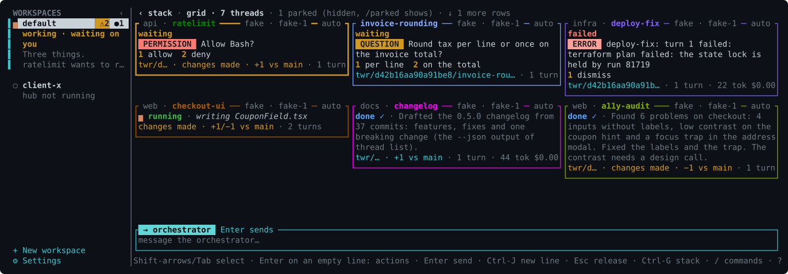
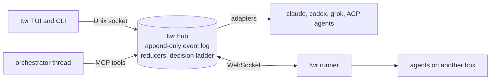

# twr

One conversation for all your coding agents.

You talk to one orchestrator, and a local hub runs the threads it starts: Claude Code, Codex, Grok Build or any Agent Client Protocol agent, each in its own git worktree by default. When a thread finishes, asks a question or needs a permission, it comes back to that same conversation, shown directly by the hub or interpreted by the orchestrator when needed. You answer there or on the thread's card, and you open a thread only when you want its full transcript.

It's a single Rust binary for Linux and macOS. No account, no cloud service, no telemetry. You bring your own agent subscriptions and twr never sees their keys.

Status: twr is before 1.0 and has one maintainer. It runs on Linux and macOS, and commands, config keys and the socket API may still change between releases. macOS is built and tested in CI, but has had less hands-on use than Linux so far.


A recorded twr session. The user asks the orchestrator for two threads, allows one push from its card's popup and a test run from the conversation, then opens a thread's transcript. The agents are scripted stand-ins; the hub, the orchestrator's tools and the TUI are the real thing. `docs/tools/make-demo.sh` records it.



The grid view (Ctrl-G), captured from the real TUI running twr's scripted test runtime, `fake`. [docs/tui.md](docs/tui.md) explains it and the stack view.

## What twr is not

twr is not a terminal multiplexer. It doesn't manage panes or depend on tmux, and it only reads a terminal in the clearly marked `pty` fallback. It's not a kanban board either. There are no tickets or columns, just live threads and the things waiting on you. And it's not an agent. It writes no code. It routes, watches, asks and summarizes, and the agents you already pay for do the work. It never answers a permission prompt for you.

## Install

```sh
curl -fsSL https://twr.tools/install.sh | sh
```

The script installs the release build for your machine in `~/.local/bin`, without sudo, after checking it against the release's checksums. You can also download an archive from the [releases page](https://github.com/ignaval/twr/releases), or build twr with Rust 1.89 or newer:

```sh
cargo install --locked --git https://github.com/ignaval/twr twr-cli
```

twr needs git and at least one agent CLI: `claude`, `codex` or `grok`. [docs/install.md](docs/install.md) covers platforms, versions, static builds and the installer's options.

## Commands

```sh
twr                                    # open the TUI; starts the hub if it isn't running
twr thread new ~/code/api --name api   # a thread on a repo, in a worktree on branch twr/api
twr thread new orbit-webapp             # or by folder name: finds ~/code/orbit-webapp
twr say "on api, add a health check"   # the hub routes it to a thread or the orchestrator
twr send api "and a test for it"       # straight to one thread
twr send api --after web "rebase on twr/web"  # held until web finishes its next turn
twr wait web                           # until web finishes or needs you; prints its report
twr attention                          # what's waiting on you, as <id>@<revision>
twr respond 01J...:1:perm-3@42 allow   # answer exactly that revision of an item
twr respond api allow                  # show api's top item, answer it after you confirm
twr park api                           # stop it and remove its clean worktree
twr trim api                           # delete its build output (target/, node_modules/, ...)
twr job run --thread api -- cargo test # a job: queued on the machine's job slots, its end told to api
twr resume api                         # recreate the worktree, same session
twr stop api                           # stop the runtime, drop queued prompts
twr delete api                         # after a y/N: move its worktree and branch to the trash
twr trash list                         # deleted threads; `twr trash restore <id>` brings one back
twr attach api                         # open the agent's own CLI on the same session
twr mode api plan                      # change a thread's permission mode (threads start in auto)
twr model api opus --effort high       # change a thread's model and reasoning effort
twr model api --runtime codex          # move a thread to another runtime, with a handoff
twr orchestrator use codex --model gpt-5   # move the orchestrator to another runtime
twr box add gpu me@gpu-box             # a box the hub reaches over SSH: it installs twr there
twr box project gpu api                # find (or clone) the project's repository on the box
twr thread new api --box gpu           # a thread on that box
twr box list                           # the boxes, their state and twr version
twr runner --hub ws://127.0.0.1:7878 --box=gpu --token-file ~/.config/twr/gpu.token
twr info                               # what the running hub uses
twr usage                              # how much of each subscription's 5h / weekly windows is used
twr usage --threads --since 7d         # what each thread's turns spent: tokens, and cost where reported
twr ws new client-x                    # another workspace: its own hub, orchestrator and threads
twr -w client-x                        # open it (`twr ws` lists them; the TUI shows tabs)
twr hub stop                           # stop the hub (and its agents' runtimes)
twr update                             # install the latest release over this twr
```

`twr say` never answers a permission or question, because it can't tell which ones you had seen. Use `twr respond`, or the TUI. [docs/usage.md](docs/usage.md) walks through a session.

## Keys

The TUI's big pane is your conversation with the orchestrator, and what you type always goes to it. The worker threads are cards beside it. To talk to one agent yourself, select its card and press `Enter` twice (or double-click it, or `/open <thread>`): the pane shows that thread and what you type goes straight to it until `Esc` brings you back. The pane's header and the input box's title say where a line goes, `ORCHESTRATOR` on cyan or `talking to <thread>` on magenta. A line that starts with `/` is a command, and a popup lists the matching ones as you type; a word that starts with `@` gets a popup of worker thread names.

There are no modes: the input box always takes what you type, so you can write to the orchestrator right away, and the keys that select type nothing (Tab, the Shift-arrows). The first time it opens, the TUI asks which agent runs your orchestrator. `Enter` sends and `Shift-Enter` starts a new line (`Alt-Enter` or `Ctrl-J` where the terminal can't tell `Shift-Enter` from `Enter`). The input box wraps long lines and grows up to 6 rows; it edits like a shell prompt (arrows, Home/End, Ctrl-W, Ctrl-K), and ↑↓ move between its rows. `Enter` on an empty line opens the selected card's action popup: the item waiting on it in full, its options numbered (a digit answers), and `talk to`, `dismiss`, `pin`, `stop`, `park`. Dragging with the mouse selects text in one pane and copies it; hold Shift (Option in iTerm2) for the terminal's own selection.

| Key | Action |
|---|---|
| Tab, Shift-Tab, Shift-↑↓ | select a card (all four Shift-arrows move in the grid) |
| Shift-←, Shift-→ | select the main pane, where Shift-↑↓ step between its long blocks and requests; back to the cards |
| Enter | send what you typed; on an empty line: open the selected card's or request's action popup, or expand/collapse a selected long block. `Enter`, `Enter` talks to a worker directly |
| 1-9 | in the action popup: answer with that option |
| Esc | close a popup, else release the selection, else back to the orchestrator from a dive; never clears what you typed |
| Ctrl-↑↓, Alt-↑↓ | scroll the main pane a line |
| Ctrl-O | show or fold tool calls (the orchestrator's, or in a dive the thread's) and the hub's updates |
| Ctrl-B | show or hide Threads, the sidebar: the workspaces, the current one's thread cards nested (Ctrl-T too) |
| Ctrl-F | toggle Focus mode: working threads and anything needing you |
| Ctrl-G | stack view or grid view (`Enter` on a tile opens its popup) |
| PgUp, PgDn, mouse wheel | scroll the main pane; scrolled up, it stays put as text streams in |
| End on an empty line, Ctrl-End | back to the bottom of the main pane, following new text |
| drag | select text in one pane and copy it (Shift-drag: the terminal's own selection) |
| ? | help, typed on an empty line |
| Ctrl-C | quit |

| Command | Action |
|---|---|
| `/open [thread]`, `/back` | talk to a worker directly, and back to the orchestrator |
| `/mode [thread] <mode>` | set a thread's permission mode (in a dive, `/mode <mode>`) |
| `/clear` | fresh orchestrator conversation, no handoff (asks `y`; keeps workers and history) |
| `/orch [<runtime> [model]]` | switch the orchestrator (alone: pick its runtime from a list) |
| `/new <project> [--runtime r] [--name n]` | start a thread in a configured project or a path |
| `/park [thread]`, `/resume [thread]`, `/stop [thread]` | default to the thread you dived into or the selected one; park and stop ask for `y` |
| `/delete <thread>...` | delete threads, moving their worktrees and branches to the trash, after you confirm the card |
| `/trash` | show the trash; `/trash restore <item>` brings a thread back, `/trash empty <item>` purges now |
| `/attach [thread]` | print the `twr attach` command to run in another terminal |
| `/parked [on\|off]` | list parked threads among the cards, or hide them |
| `/pin [thread]` | pin or unpin a thread's card |
| `/grid`, `/decisions` | the grid view; the decision audit table (`Esc` closes it) |
| `/sidebar [on\|off]` | show or hide Threads, the sidebar |
| `/focus [on\|off]` | show only working threads and threads needing you, or list all |
| `/mouse [on\|off]` | select and copy with the mouse in the TUI, or leave the mouse to the terminal |
| `/help` | commands and keys |
| `//text` | send a line that starts with `/` |

On a phone (below 60 columns, or `/compact on`) it shows one screen at a time: the conversation, what needs you, the threads. More in [docs/tui.md](docs/tui.md).

## How it works

Everything is an event in an append-only SQLite log. Thread state, the attention stack and reports are reducers over that log. Adapters drive each agent CLI through its headless JSON mode and turn its output into one small event schema. The orchestrator is another thread that works through the hub's tools over MCP. It can relay an answer you typed, but it can't decide one. Threads on other machines run under a box daemon the hub reaches over SSH (`twr box add`), or under `twr runner`, which connects out to the hub over WebSocket.



[docs/architecture.md](docs/architecture.md) has the details. [SKILL.md](SKILL.md) documents the socket API and the MCP tools for any agent that wants to drive twr.

## Security

Agents run as your OS user, so they can do what you can, within whatever sandbox their runtime applies. twr adds a guard on its own controls. The agents it runs may only read the hub and run [jobs](docs/usage.md#jobs) for their own thread: they can't answer a permission or question, change a mode, delete threads or send prompts. The orchestrator relays your answers and mode changes only under the [relay rule](docs/orchestrator.md#the-relay-rule), and deletes nothing without your confirmation. It is not a sandbox: [docs/security-model.md](docs/security-model.md) says what twr guarantees, how, and what it doesn't protect against. For repositories you don't trust, use a runtime's sandbox or run workers as a separate OS user or in a container.

Report a vulnerability privately, as [SECURITY.md](SECURITY.md) describes, not in a public issue.

## Documentation

- [Install](docs/install.md): installer, releases, platforms, building from source
- [Usage](docs/usage.md): threads, answering cards, reports, attach, standing context
- [TUI](docs/tui.md): views, keys and slash commands
- [Configuration](docs/configuration.md): every key in `config.toml`
- [Notifications](docs/notifications.md): a command the hub runs when something needs you: phone, desktop, Slack
- [Runtimes](docs/runtimes.md): Claude Code, Codex, Grok Build, ACP agents, PTY
- [Orchestrator](docs/orchestrator.md): the relay rule, mode changes, reports, switching, handoff and clearing the conversation
- [Worktrees](docs/worktrees.md): per-thread worktrees, the shared checkout, park and resume
- [Runners](docs/runners.md): threads on other machines
- [Architecture](docs/architecture.md): event log, reducers, decision ladder, adapters
- [Security model](docs/security-model.md): what twr guarantees, how, and what it doesn't protect against
- [Development](docs/development.md): tests, fuzzing, CI, releases, screenshots

## Contributing

Bug reports, ideas and pull requests are welcome: [CONTRIBUTING.md](CONTRIBUTING.md) says how. Development happens on `dev`, the default branch, and `main` is the latest release. Everyone taking part follows the [code of conduct](CODE_OF_CONDUCT.md). [CHANGELOG.md](CHANGELOG.md) lists what changed in each release.

## License

Apache-2.0. See [LICENSE](LICENSE) and [NOTICE](NOTICE).

twr is not affiliated with Anthropic, OpenAI or xAI. Claude Code, Codex and Grok are trademarks of their owners. Each agent CLI runs under your own account, so its provider's terms apply to how you use it through twr; for heavy automation, an API key is the safe choice.
