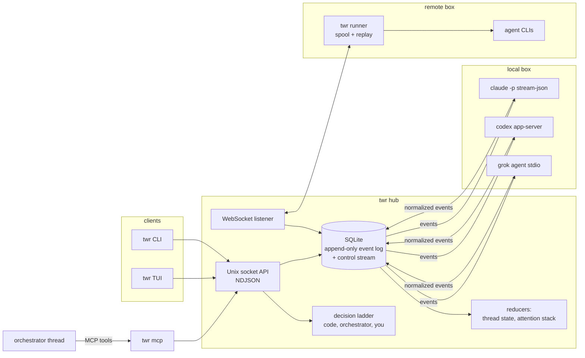

# Architecture

## The hub

`twr hub` is one process per user. It listens on a Unix socket, mode 0600 in a 0700 directory, so only its owner can connect, and every client (the CLI, the TUI, `twr mcp`) refuses a socket whose listener runs as another user. Bare `twr` starts one in the background when none answers, with its log in the data directory as `hub.log`. Clients speak newline-delimited JSON over the socket. [SKILL.md](../SKILL.md) is the full reference for the methods, events and MCP tools.

## The event log

Everything is an event in an append-only log in SQLite: one stream per thread, plus a global control stream. Each event has an id, a per-thread sequence number, a timestamp, a thread, a turn, a source and a kind. The source says who wrote it: an adapter, the hub, a user client, the orchestrator or a decision provider.

The control stream carries what clients care about across all threads: thread lifecycle (`thread.created`, `thread.started`, `thread.stopped`, `thread.crashed`, `thread.parked`, `thread.resumed`, `thread.attached`, `thread.detached`, `thread.mode_changed`, `thread.model_changed`, `thread.deleted`), turn starts and ends, session-scoped task updates, attention items, reports, decisions, git snapshots, runner connections, context updates, context compactions (`context.compacting`, `context.compacted`), worktree disk measurements and trims (`worktree.disk`, `worktree.trimmed`) and subscription usage (`account.usage`, on the hub's own thread: the latest usage windows of a runtime's account, which the hub folds from its adapters' `runtime.limits` reports without recording those; see [runtimes.md](runtimes.md#subscription-usage)).

A subscription delivers what is stored after the client's `since`, then live items, with no gaps or duplicates. The TUI asks for its control backlog compacted (`control.subscribe` with `compact`): of the stored items up to the head of the moment, the hub sends only those that change what a client folds, with their real gseqs, then every live item after the head. Most of a long-used log is `task.updated` progress and heartbeats; a compacted backlog keeps, of a task, its first update and its latest ones while it runs at the head, and its start and end only when something read the thread's tasks while it ran (a report, a stop, park, crash, attach, restore or runtime start), every job's end, and of `git.snapshot`, `worktree.disk` and `account.usage` the latest per thread (and per runtime and account). The guarantee: folding the compacted backlog into the shared reducers (twr-core's `Registry`, `AttentionStack`, `UsageView` and notification `Policy`) and the TUI's decision table gives the state folding every item gives, except three fields no client reads from the control stream: a thread's `last_activity`, `worked_at` and `last_seq`. Every `attention.*` item is kept and the TUI stands at the head once the backlog is applied, so attention revisions, what the TUI has seen and `said_after` work as with the full log. The selection is a pure function of the stored rows and the tasks present at the head (`twr_core::compact`); the hub takes the head and those tasks under its lock, and selects outside it, over the rows its replay kept (about 15 ms for 46 000 items) and those of later items, read from the store. `control.read`, `twr control` and the MCP tools read the full log.

A client can skip the backlog altogether: `control.subscribe` with `snapshot` (from `since` 0) is acknowledged with the state at the head instead of the items up to it. The hub keeps what a client folds of the control stream (`twr_core::client_state::ClientFold`: the registry, the attention stack, the usage view, the notification memory for every event, the newest 200 decisions and how many there were, the turns messages started, the turns that raised a request, the `!` commands that ended, the stalls that went on, the open delete cards and the requests known only by a capped preview) and folds every control item into it as it commits it, with its whole payload, before any subscriber gets the item. A subscription takes a copy of it with the head and the live receiver under one lock, serializes it outside the lock into its ack (`{since: head, head, snapshot, snapshot_fold}`), and delivers every item after the head once, live or from the store. The state is a few hundred KB whatever the log's length; one over 4 MiB is not sent, and the ack is then the one without `snapshot` (the backlog from the start, compacted with `compact`, prepared under the same lock). Older decisions are read when wanted: `decisions.list {before, limit}` returns the `decision.made` items before a gseq, newest first. `snapshot_fold` names the code that folded it (a hash of twr-core's sources and the locked dependencies): a client installs only a snapshot of its own fold, since another build's reducers may fold the same items otherwise, and asks again without one (a new TUI on a hub still running an older build replays the compacted backlog until that hub restarts). A hub from before refuses `snapshot` and `decisions.list`, and a client falls back to the compacted backlog.

`thread.mode_changed{mode, previous, by}` records a new permission mode for a thread, set by you or by the orchestrator relaying what you asked (`by: user | orchestrator`). One with `mode == previous` records that you chose the mode the thread already had: nothing changes or restarts, but an earlier request of yours to the orchestrator no longer covers that thread's mode. The thread's mode is `thread.created`'s, then the latest `thread.mode_changed`'s, and every runtime start uses it. A live runtime started in the old mode is stopped once it is idle and started again on the same session; that stop is a `thread.stopped` with `ext.twr.reason: "mode_change"`, which doesn't mark the thread stopped. `thread.model_changed{model, effort, previous_model, previous_effort, by}` does the same for the thread's model and reasoning effort (null is the runtime's default), set by you or by the orchestrator when you ask it; its restart's stop says `"model_change"` (or `"mode_change"` when the mode changed too). With `runtime` and `previous_runtime` it moves the thread to another runtime: the old runtime stops with `"runtime_change"` and isn't started again, and the thread's next turn starts a new session of the new one, its prompt prefixed with a handoff built from the log (`turn.started` `ext.twr.runtime_handoff`). `thread.deleted` records that you confirmed deleting a thread: its runtime stopped, its worktree removed (or, when git could not remove all of it, left without its `.git` and named in `worktree_left`) and its branch deleted. The thread then leaves every listing, and nothing more is recorded on it. The control stream never carries agent text or tool calls; those stay in the thread's own stream. Each control item has a global sequence number, `gseq`, and a subscription delivers the stored backlog and then live items with no gaps or duplicates.

Payloads over 4 KB keep a preview in the event, and the rest moves to a content-addressed blob store. `twr events --hydrate` puts it back.

## Reducers

Thread state, the attention stack and reports are reducers over the log. Nothing else is stored. Replaying the log from the start gives the same state as the live hub, which is how a hub restart recovers and what the runner fuzz harness checks.

Folding a long log takes seconds, so the hub keeps checkpoints of its folded state in its database (`checkpoints`, the newest two of each of the three builds with the newest ones; the state includes what clients get as a snapshot). Each one is the state as of one control event. It is written in the background from a replay of the log alone, never from the live state (which holds runtimes, leases and the orchestrator's token): soon after the hub opens and then every hour, once 5 000 or more events came after the newest checkpoint. A hub start loads the newest checkpoint it can use and folds only the events after that event, which it finds by id. A checkpoint of another format, another build (its version and a hash of the sources the hub's fold was built from and of the compiler and settings that built it, taken at build time, so a start reads nothing to tell) or other `[notify]` settings (the notification policy is part of the fold), one whose SHA-256 checksum no longer matches its row, or whose event the log doesn't have at that control position, is passed over with a warning in `hub.log`; with none left the whole log is folded. A payload the writer cannot hydrate fails the write, so no checkpoint keeps a preview. Either way the state is the one the whole log folds to, which the checkpoint tests check byte for byte and through the reducers and the hub's answers. A checkpoint is a cache: `twr log compact --drop-checkpoints` (or `DELETE FROM checkpoints` in `twr.db`) loses nothing, and the next start folds the whole log.

A new build uses none of an older build's checkpoints, so its first start would fold the whole log. To spare that, a build writes its own before its hub restarts: `twr log checkpoint` (from the newest checkpoint of this build it can use, else from nothing, on connections of its own, while the old hub runs), which `docs/tools/dev-install.sh` and `twr update` run for every workspace after installing, and `twr hub stop` runs before stopping a hub, unless that hub runs this very build (`hub.info` `checkpoint_build`; a running older hub keeps only its own newest two, and may have dropped the one written at install). One up to date is left alone. The writer reads the checkpoints, the events and their payloads in one read transaction, so what another connection commits meanwhile (events, a compaction and its `VACUUM`) does not change what it folds. It never touches a database of another schema, which the new hub's start migrates.

### Archive and prune

Most of a long-used log is what agents said, thought and did (`agent.*`), most of it in old turns and deleted threads that nothing reads again. The hub moves those events out of `twr.db` into `archive.db` beside it (`hub::prune`; `[log]` in [configuration.md](configuration.md)), with the blobs only they reach. What moves: every agent event of a deleted thread whose trash item of its latest deletion is purged, and, of any other thread, those of each turn that ended more than `retention_days` (30) ago and whose reactions are complete (a worker's report, an interrupted turn, an orchestrator turn that did not fail or whose error item is raised), except its final reply, anything of the thread's last turn or after its start, and a turn a recorded command for a remote box still names. Control events never move: a trigger lets `twr.db` delete agent events only. What the hub folds from agent events is the open turn's activity, which the last turn sets, so a fold of the log is the same before and after (the tests compare them, and checkpoints stay valid).

Purges are in the log: every trash item the hub purges, by `trash.empty` or after `keep_days`, is recorded as `trash.purged {item, thread}` on the hub's thread, and so is an item of the hub's own box past its purge time whose directory is not there (`gone: true`: purged before purges were recorded, or by hand; one the box could not list is not). A remote box's item is recorded purged only from that box's own answer, for the ids it was asked about and items the log knows as that box's. Known limitation: when that answer is lost (a crash, a failed append), nothing is recorded, the item is still listed for the box while it is offline, and its thread's agent events are not archived as a purged thread's (only the per-turn retention applies). The fold drops the item and marks its thread not restorable; a thread comes back only from the item of its latest deletion. The archive holds every blob its events reach, those shared with events that stay too, so it never needs `twr.db`.

A run copies the rows into `archive.db` and commits, then deletes them from `twr.db` in short transactions (at most 500 rows or 8 MB of blobs, committed after about 30 ms; on the real copy none held the write lock longer than 85 ms, and nothing is scanned while it is held) with a pause between, each only once its copy is there; then the same for the blobs no row left in `twr.db` reaches (pointers in each row's `data` and `raw`, and in the blobs those reach). It runs on connections of its own in the background, under no lock of the hub's, which keeps writing meanwhile; a crash leaves rows in both databases, readers take `twr.db`'s, and the next run finishes. Every hour the hub runs it when 2 000 rows or more can move; `twr log compact` runs it now (users only), and `--vacuum` then rewrites `twr.db` (`VACUUM`, which keeps the rows in order; the hub waits for it: 3 to 18 seconds for a 475 MB `twr.db` on a loaded machine) and turns on incremental vacuum, with which later runs give free pages back a few at a time. `thread.events` (`twr events`) and `blob.get` read the archive too, and `thread.events` takes a deleted thread's id.

A thread's status is one of `idle`, `running`, `background`, `waiting`, `done`, `error`, `parked` or `attached`. The attention stack orders items by reason, then age: permission, question, error, review, stalled. The TUI puts threads with items first, in that order, then running/background, failed, done, idle and parked threads.

`task.updated {task_id, running, description, heartbeat}` is on the control stream, with no turn number. The reducer keeps a map of running tasks across `turn.ended` and `report.ready`. An open turn is `running`; with no turn and at least one task it is `background`. Permission/question items still take precedence as `waiting`. Idle/done require both an empty task map and no open turn. Terminal task updates remove by id; duplicate completions do nothing. Stops, parks, crashes and new runtime process starts clear the map. Runtime-generated follow-ups are recorded as `turn.started {from: runtime}` and receive the next hub turn number, without a user prompt. Only the hub numbers turns. Adapters send a runtime's own turn and its events without a number. The start and end of such a turn carry the adapter's own id for it (`ext.twr.runtime_turn`). If the hub has a turn of its own open when the start arrives, because a prompt is on its way to the runtime, it drops the start. The runtime turn's output then goes into the open turn, and its end, whose id isn't the open turn's, closes nothing. Its usage is added once to the end of the turn that took it in. The hub keeps that link in memory, so a hub restart in between loses the usage. The hub decides from the log alone, so a runner's replay gets the same answer. A request that belongs to the runtime's session rather than to its turn, such as a Codex child agent's approval, carries `ext.twr.session` and is recorded outside any turn, so a turn's end doesn't close it.

Thread JSON adds `background_task_count` and `background_tasks` (id → description and last liveness timestamp), and `activity`, one line on what the thread does now, which the hub folds from the same events without recording anything (`hub::activity`, phrased by `twr_core::activity`). The CLI, MCP, TUI cards/grid and status line all derive their display from that state; background threads remain visible in Focus mode and animate like running threads.

A report for a turn that yielded to tasks remains available as an interim report (`ext.twr.background_tasks`, with each task's id and start in `ext.twr.background_task_starts`). A `report.write` for that turn while any of those tasks still runs keeps the marker and raises no review; tasks a later turn started, or an id reused by a new task, don't count. A `report.write` for a follow-up turn keeps `ext.twr.turn_from`. It does not raise a completion/review notice and fires no watch. The conversation says the worker "yielded with N background tasks still running (interim report: the result comes later)"; the last task completion produces one background-finished update when no turn is open. Progress and intermediate completions do not produce conversation notices. An automatic follow-up turn gets its own final report, marked `ext.twr.turn_from: "runtime"`; the conversation says the worker "finished, in a follow-up turn it started after background work". An orchestrator watch fires on that final report, or, when no follow-up turn starts within 5 seconds of the tasks ending, on the idle worker ([orchestrator.md](orchestrator.md#watches)).

When the last of a worker's tasks ends (not a user's `!` command) with no turn open, its last turn completed and its report interim, the hub waits `wake_after_secs` (30 s; `hub::wake`) by log time. If by then no turn started, no task started again and nothing is queued, and the thread is not stopped, parked, attached, crashed or waiting on the user, it queues a prompt of its own (`from: runtime`, source `hub`, like a job's wake) listing what ended since that turn, each job with its result and log, with a `conversation.update` on the worker recording `ext.twr.auto_wake = {turn, tasks}` in the same batch. At most one wake per interim report (its turn) and 5 in a row with no turn the user or the orchestrator started in between; past that the hub records `ext.twr.auto_wake_skipped = {turn, why}` instead. Both are folded from the log; a wake still waiting is memory only, so a hub restarted meanwhile wakes nothing. A runtime being stopped (a settings restart) or a box offline holds a wake up for up to 10 minutes, and the idle line waits with it. A turn the Claude Code adapter opened for a notification and ended `no_run` handled nothing: its report repeats the interim report it followed (`ext.twr.no_run_of`, said nowhere again), so the worker counts as idle after an interim report, for the wake (at once, or when its last task ends), the idle line and `send --after` alike. The orchestrator's held idle line waits for the wake's decision, and the wake's record (`ext.twr.auto_wake`) drops it. A `send --after` gate counts a worker with a wake pending as not settled.

The orchestrator's own background work also defers automatic notice turns. User prompts may still reach a runtime between turns while tasks are live; twr does not interrupt those tasks to deliver a prompt. Settings restarts wait for the task map to empty.

Stall detection includes background work, but inventory heartbeats only renew task liveness; they do not claim progress or dismiss a stalled card. The hub records fewer task updates than adapters send (`hub::coalesce`, for local runtimes and runner frames alike; a frame it does not record is still acked): a task's start, end and any update with `ext` always; any update once the task's last recorded update is 10 minutes old (a quarter of `background_timeout_secs` when that is shorter), so its lease is renewed in time, and a heartbeat only then; progress at most every 30 seconds per task otherwise (a tenth of the hung-turn threshold when that is shorter); a heartbeat with a new description at most that often after the last recorded update, as a heartbeat (no activity). The heartbeat rule reads the view, which the log builds, so a restarted hub decides the same; when progress was last recorded is memory only, so a restart records one more progress per task, never less. A stall and a hung turn need ten times the progress interval of silence, so the first progress after one is always recorded and closes it. `hub.info` counts what was not recorded (`coalesced_events`). No stall is raised while a job of the thread's own runs or waits for its slots, as the hub that runs it knows (jobs never outlive their hub): its turn or its runtime's watcher waits on it. A job's task is renewed every 5 minutes; what the hub shows of it (the activity line, `thread.get`) is what it does now, read off the job. A turn open and silent for `min(stall_after_secs, 5 min)`, counted from its last event and from when the oldest prompt queued for it arrived, while that prompt waits, gets a hung-turn card instead of a plain stall: a hub `stalled` item with `ext.twr.hung = {turn, waiting}` and the options `interrupt` (the turn is interrupted as `message.send_now` does, and what waits runs next) and `wait` (no other hung-turn card for that turn). It replaces an open plain stall in the same batch, closing it `by: timeout` with `ext.twr.superseded_by` set to the card's id (its activity did not resume). A stall closed by its thread's own work, in that work's batch (the runtime's text, thinking, tool calls and results, a request, a task moving, a turn it started or completed), says so with `ext.twr.went_on: true`, unless the batch also ends that work (a stop, crash, park or attach, an interrupt, a turn taken back or ended otherwise than completed, an `error` item); one closed any other way, or at startup, has none. A summary's basis reads past a stall that went on, as the TUI folds it. The hung-turn card notifies as `hung`, and reaches the orchestrator as an urgent `reason=hung` line; only the user answers it. Settings restarts wait for tasks to drain. Park/attach require force while background work runs. Stop and forced park use the existing durable stop and process-group/marked-descendant reaping paths. Remote frames carry the same task events and generation fencing; reconnects retain tasks for live sessions, and missing runtimes clear them.

## Attention items

An attention item is something waiting on you. Agents raise permissions and questions. The hub raises routing questions, reviews, errors, stalled notices and hung-turn cards. Each item has an id and a revision, the control `gseq` of its latest raise. An answer names the revision it was given for, and the hub refuses it if the item was raised again since. [usage.md](usage.md#answer-permissions-and-questions) shows how that looks from the CLI.

## The decision ladder

Three places in the hub need a judgment call:

| Site | Question | Default when nothing answers |
|---|---|---|
| `route` | which thread gets an unaddressed message | ask you |
| `grade` | how a finished turn went | `success` at 0.6 |
| `block_kind` | whether a failed turn is transient | needs you, at 0.5 |

A message a client sends with `say {to: "orchestrator"}`, as the TUI's orchestrator conversation does, skips the `route` site and goes to the orchestrator as if the ladder had delegated it.

Each site is a ladder of providers. Code rules go first. For `route`, the orchestrator comes next, then you; for `grade` and `block_kind`, the site's default. The first answer wins. Every rung that answered is logged as a `decision.made` event with its confidence and latency, so the TUI's decisions table (`/decisions`) can show who decided what.

## Adapters

Adapters drive each agent CLI through its headless JSON mode and turn its output into a small shared event schema: `agent.text`, `agent.thinking`, `agent.tool_call`, `agent.tool_result`, `attention.raised`, `turn.ended` and so on. Runtime-specific extras go under `data.ext.<runtime>`.

A new runtime is one file in `crates/twr-adapters` that implements the `Adapter` trait from `twr-core`. `spawn` starts a session and returns a handle: the adapter sends events up and takes `send`, `respond` and `stop` commands. `resume` reopens a session, and `attach_command` names the interactive CLI for `twr attach`. [runtimes.md](runtimes.md) lists the adapters and their tiers.

## The orchestrator

The orchestrator is just another thread, running whatever runtime you configure, with the hub's tools exposed over MCP by `twr mcp`. The hub gives each orchestrator process a fresh token, passed to its MCP server through a 0600 file and never on a command line. A connection that presents the token is the orchestrator and may call only a subset of the socket methods. A connection from a process the hub started for a thread, or from one of its children, is that thread's agent: it may read, and start and cancel its own thread's jobs, starting them only while the thread's mode may run commands ([usage.md](usage.md#security)). The relay rule decides when it may pass on your answer. The hub checks where the message came from and what was on screen when you sent it, then reads the message itself: a message that is one short command is applied at once, and anything else goes on a confirm card that only you can answer. See [orchestrator.md](orchestrator.md).

## Runners

A runner runs one remote box's threads. It connects out to the hub's WebSocket listener, spools events on disk while disconnected, and replays them on reconnect. The hub commits each event with the runner's watermark before acknowledging it, so nothing is lost or recorded twice. See [runners.md](runners.md).

## Crates

| Crate | What it holds |
|---|---|
| `twr-core` | events, reducers, attention stack, the `Adapter` trait, config, socket protocol |
| `twr-hub` | the hub: event store, control stream, socket API, adapter supervisors |
| `twr-adapters` | the runtime adapters |
| `twr-decisions` | the decision ladder and its code and orchestrator rungs, and the short-command reading of the orchestrator's relayed answers and mode changes |
| `twr-mcp` | the MCP server that exposes the hub to the orchestrator |
| `twr-docs` | twr's docs compiled in, split into sections and searched, for the orchestrator's `read_docs` |
| `twr-runner` | `twr runner`, worktrees and git snapshots, local and remote |
| `twr-tui` | the terminal UI |
| `twr-cli` | the `twr` binary |
