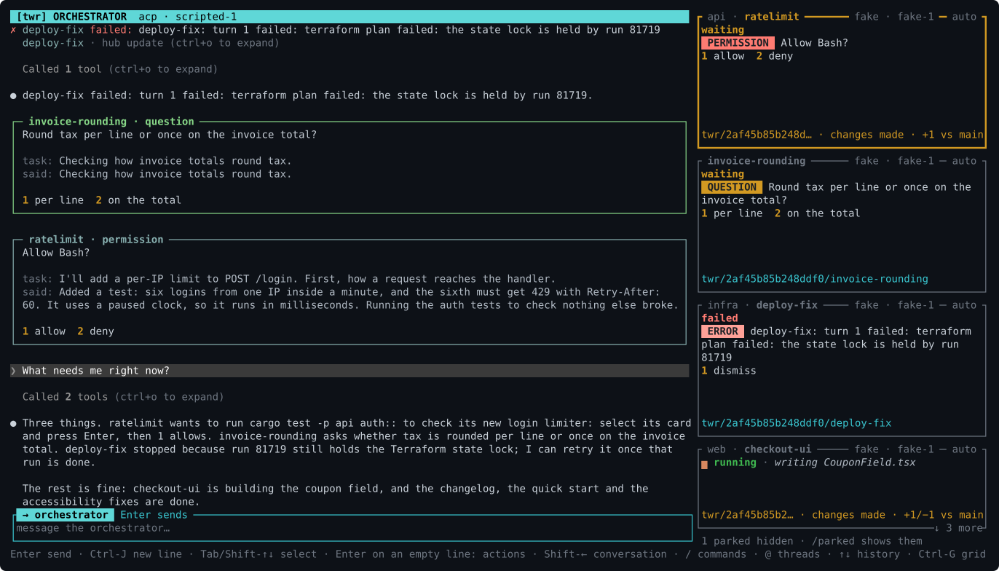
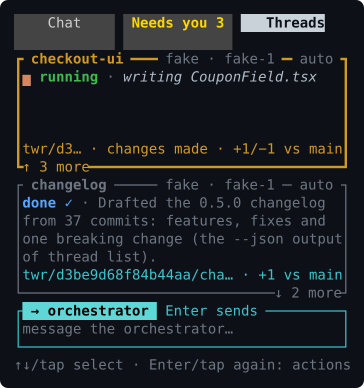

# The TUI

`twr` with no arguments opens the TUI, and starts the hub in the background if it isn't running. Quit with Ctrl-C or `/quit`; the hub and its threads keep running.

## Choosing the orchestrator

The first time the TUI opens, it asks which agent runs your orchestrator:

```
╭ choose the orchestrator ───────────────────── ✕ ╮
│Pick the agent that runs your orchestrator        │
│(you can switch any time with /orch)              │
│                                                  │
│› 1 claude-code  installed  (default)             │
│  2 codex        not installed                    │
│  3 grok-build   installed                        │
│                                                  │
│↑↓ or 1-9 pick · Enter choose · Esc decide later  │
╰──────────────────────────────────────────────────╯
```

It lists the runtimes that can host the orchestrator and whether each one's program is installed, with the configured default selected. `↑`/`↓` or `1`-`9` pick one and `Enter` chooses it: the hub records the choice in its event log (`orchestrator.use`), so the question isn't asked again. `Esc` closes it without choosing; the default then starts with your first message, and the TUI asks again next time. With the mouse, a tap on a runtime picks it, a tap on the picked one chooses it, the wheel moves the pick, and the `✕` on its top border does what `Esc` does. While it is open, other keys do nothing, so nothing you type is lost to it or sent by mistake.

The TUI only asks when no orchestrator was ever chosen: no orchestrator thread exists, current or retired, and the config doesn't set `[orchestrator] runtime`.

`/orch` with no arguments opens the same list to switch the orchestrator, titled `switch the orchestrator`, with the current one marked `(current)` and selected. Choosing one doesn't switch yet: the status bar asks to confirm, `y` with the current orchestrator's handoff summary and `s` without. `Esc` closes the list and nothing changes.

## Workspaces

With more than one [workspace](workspaces.md), a strip of tabs tops every view, one per workspace: ` default ⚠1 ●2 │ client-x ●1 │ scratch ○`. `⚠` counts the permissions and questions waiting on you, `●` the threads running, and `○` marks a workspace whose hub isn't running (`…` one that didn't answer). The current one is highlighted, and the strip names it in place of the `[instance]` label. When the tabs don't fit, the strip shows the ones around the current tab, with `‹` and `›` for the rest.

A click on a tab, `Alt-1` to `Alt-9` (the tab at that place), `Ctrl-PgUp` and `Ctrl-PgDn` (the previous and next tab) switch, whatever is open, a new workspace's first-run question included. `/ws <name>` switches too; for a name that doesn't exist yet, it asks `y` to create the workspace. `/ws` alone lists them.

The TUI is connected to one hub at a time: switching opens the other workspace's hub, starting it if it isn't running, and replays its log as opening the TUI does. What you left in a workspace is kept for when you come back: the line you were typing (not a history entry Up was showing), the selected card and request, pins, the view, the conversations it showed with their scroll positions, a confirm card's scroll, the selected decision, and the thread you were talking to, if it's still there. What you sent just before switching still goes to the workspace you left; if it fails, the status bar says so, naming that workspace. Every five seconds the TUI asks the other running hubs for their counts; with [notifications](#notifications) on, a workspace that gets a new permission or question notifies you, naming it. A TUI opened with `--socket` shows that hub alone.

## Stack view



The stack view is the default. The big pane is your conversation with the orchestrator, and it always is: whatever card is selected, a line you type goes to the orchestrator. The worker threads are cards in a column on the right, running down beside the input box, so the cards keep their height however tall the box grows. Below 100 columns the cards move to a row above the conversation instead.

`Ctrl-B` toggles the thread sidebar, including the card row on narrow terminals (inside tmux, where `Ctrl-B` is the prefix key by default, use `/sidebar`). `/sidebar on` and `/sidebar off` set it explicitly. With the sidebar hidden, the conversation uses the full area; hidden cards can't be selected, so nothing answers them. Worker requests drawn in the conversation itself can still be answered: select one there (`Shift-←`, then `Shift-↓`, or a click) and press `Enter` for its [action popup](#the-action-popup), under the same guards as a card. The popup acts on the request alone, never on another thread. The status bar keeps a count of threads needing you and says `Ctrl-B shows`; a tap on that note shows the sidebar again. The orchestrator's own attention banner stays visible. From the grid or the decisions overlay, the sidebar shortcut returns to the conversation.

`Ctrl-F` toggles **Focus mode**, or use `/focus on` and `/focus off`. The sidebar and grid then show running, waiting, failed and attached threads, and every thread with an open attention item. Idle and completed threads are hidden, while pinned threads and the thread you have opened stay visible. Threads reappear as soon as they start working or need you, and disappear when they finish successfully and have no open item. Hidden threads remain available to `/open`, other commands and `@` mentions. `/parked` can still list parked threads. The status bar shows `Focus`, the number hidden, and `Ctrl-F all`, and a tap on that note turns Focus mode off. Both shortcuts work whatever you are typing, and the settings last for the current TUI session.

The pane's header is a filled cyan band across its top that says who you are talking to: `ORCHESTRATOR` in bold, then the orchestrator's runtime and the full model id the runtime reports (`ORCHESTRATOR  claude-code · claude-opus-4-1-20250805`). The pane has no border of its own, so the conversation gets the whole width: the band is where it starts, a blank column keeps it apart from the column of cards, and the input box's border is under it. Before there is an orchestrator, it names the one the hub will start with your first message. The input box's title carries the same label on the same color, `→ orchestrator`, so you can see where a line will go before you send it. On a narrow terminal the details are cut first and the label last. The pane shows your messages and the orchestrator's replies the way Claude Code shows a conversation, with a blank line between blocks:

- your message after `❯`, as you typed it, on a grey band across the pane;
- each reply after `●`, its markdown (CommonMark) drawn: bold text bold, `code` in light blue without its backticks, headings bold without their `#`s, lists with a hanging indent, code blocks without their fences, quotes after a dim bar, a line break where the agent wrote one. Markers that close nothing (a reply still streaming in) stay as written;
- the orchestrator's tool calls, its twr actions, become one dim line per run of calls saying what they did, such as `Listed the threads, sent 1 message (ctrl+o to expand)`, with failures in red;
- the hub's updates take a row each (more when what they say is longer or has several lines): a worker's request shows `! api needs permission: …` while it is open (the request's own box is in the conversation then), and once it ended, `✓ api allowed · <what it asked>` (`✗ … denied` in red, `· … closed` when nobody answered, `answered <x>` for a question). A failure reads `✗ api failed: …`. Three or more ended requests in a row fold into one row that says how they ended, such as `✓ 8 requests · 7 allowed, 1 closed · api (ctrl+o to expand)`. A worker's report is a block of its own: `● api finished · success`, then its summary. An exact-command acknowledgment shows your message too;
- what the orchestrator read of your projects takes a row each, served or refused, in any of its turns: `read api:README.md (4 KB), at 1a2b3c4d5e6f`, `searched api for "parse_config" (2 KB), at …`, `refused to read api:.env: …` (see [Reading your projects](orchestrator.md#reading-your-projects));
- the hub's notices to the orchestrator (`[twr notice]` turns about what the threads did) become `hub update (ctrl+o to expand)`. The orchestrator's reply to a notice stays visible, since that reply is what tells you what happened;
- a turn that completed has no line of its own, unless it took a minute or more (`✻ Worked for 1m 15s`); one that failed or was interrupted ends with `✗ The turn failed after 3.2s` or `! Interrupted`.

The part of a reply about one worker thread sits in a box across the pane, titled with the thread's name and status and drawn in the thread's color (`╭─ orbit-webapp-1 · running ───╮`). The orchestrator marks these parts itself (see [orchestrator.md](orchestrator.md)). Each thread keeps its color, and none of them is the cyan, magenta, orange or yellow used elsewhere; a name that matches no thread gets a dim grey box. A box still streaming in stays open at the bottom until the reply is finished. It is only the orchestrator's text, not a card, and a mouse copy takes its title and text without the frame. A folded line whose calls or updates are all about one thread names it the same way: `orbit-webapp-1 · Checked 1 thread, sent 1 message (ctrl+o to expand)`.

`Ctrl-O` expands every folded line, in the conversation and in every dive alike (it is one setting), and pressing it again folds them back. A click on one folded line expands just that one. Copying with the mouse copies what is on screen, folded or not, without the `●` and `❯` marks and the indentation: a wrapped paragraph or list item is one line again. Expanded, a tool call reads `● Bash(cargo test)`, the dot green once it succeeded and red (with `⎿  failed` under it) when it failed.

When the orchestrator itself needs you, for example when the hub reports that it crashed, a `the orchestrator needs you` box sits at the top of the conversation with the item and its numbered options. It isn't a card, but `Tab` or `Shift-↓` select it like one (it comes first), and `Enter` opens its [action popup](#the-action-popup) the same way. The box is only in the conversation: in a dive or the grid it isn't drawn, so it can't be selected or answered there (the grid's header says the orchestrator needs you). Switching to a view that doesn't show the selected card lets go of the selection.

The cards are ordered by what needs you: permissions first, then questions, errors, reviews and stalled notices, the oldest item first in each. Then come working threads (running, waiting on background tasks, or attached), failed, done, idle and parked ones. Among those, within a group, threads keep the order they were created in, oldest first, so a card doesn't change places each time its thread does something, and a thread that waits on background work or starts its follow-up turn stays where it is. Creation order, rather than when a thread entered its group, gives every thread the same place each time it comes back to a group, and the same order after the TUI restarts. Pin a thread from its action popup, or with `/pin [thread]`: its title gets `[pin]` and it comes first in its group (among cards that need you, which go by their items, it wins ties). Pinning or unpinning puts the cards in order at once.

Only a card that comes to need you moves at once: a new permission, question, error, review or stall brings it to the top right away. Every other move waits about three seconds: a thread finishing, failing, going idle, or leaving the top once you answered its item. It also waits while you're using the cards: while a card or tile is selected, while its action popup or a detail view is open, and while the mouse pointer is over the cards (for at most 30 seconds after it last moved, and not after the terminal loses focus). Once nothing holds them, the cards move to their new places all at once. A new thread's card shows right away, in its place, and a deleted or hidden one goes. The same order holds in the column, the row of cards above a narrow conversation, and the grid. A list you scrolled down keeps showing the same card first when a card above it comes or goes.

Cards have a fixed height: 7 rows (a title, 4 rows of status and report, the git line and the border), or 11 with an item open, the size a card keeps until its move is applied. A card's text changing (what it's doing, its report, its git state) never shifts the cards below it. A report too long for its card ends in `…`; the full report is in the card's action popup, the dive and the conversation. Grid tiles and the row of cards were fixed-height already.

`[tui] card_order = "attention"` brings back the old order: within a group, the most recently active thread first, every move at once ([configuration.md](configuration.md)).

Parked threads are hidden by default, unless one is pinned, has an open item (so a failure on a parked thread stays in view) or is the thread you are in a dive into. A dim line under the cards says how many are hidden, such as `2 parked hidden · /parked shows them`; where the cards have no room for it (the narrow row above the conversation, even with no card in it, or a grid header too narrow for it), the status bar's hints start with it. `/parked` lists them among the cards, and so does a tap on the note; `/parked` again hides them (`/parked on` and `/parked off` set it). Hidden threads still work everywhere else: commands, Tab completion and `@` mentions name them. Cards have a fixed height (see above). When they don't all fit, the edge cards say `↑ N more` or `↓ N more` (`< N more` and `N more >` in the narrow row).

A card's title says which thread it is and who runs it: at its left the thread's project, dimmed, then its name (`twr · scroll-follow`); at its right the runtime and model (`claude-code · sonnet-4-5`), with the box token of a thread on a remote box (see below), then its permission mode, apart (`─ auto`). Under the title, a card has one section about the thread's status, and its git state on its last row:

```
┌ quickstart ─ claude-code · sonnet-4-5 ─ auto ┐
│done ✓ · Rewrote the quick start around three │
│commands and moved the config reference to its│
│own page. All 41 links resolve; the old       │
│anchors redirect.                             │
│twr/quickstart · 2 ahead of main              │
└──────────────────────────────────────────────┘
┌ scroll-follow ──────────── sonnet-4-5 ─ auto ┐
│▃ running · implementing scroll anchoring ·   │
│running tests                                 │
│                                              │
│                                              │
│twr/scroll-follow · changes made · +3 vs dev  │
└──────────────────────────────────────────────┘
┌ api-tests ── claude-code · sonnet-4-5 ─ auto ┐
│▃ running tests · cargo test --workspace      │
│ STALLED  No output for 12 minutes            │
│1 wait  2 interrupt                           │
│                                              │
│                                              │
│                                              │
│                                              │
│                                              │
│twr/api-tests · changes made · +1/−2 vs dev   │
└──────────────────────────────────────────────┘
```

Where the title has no room for all of it, the project gives way first: it is cut with `…` (`orbit… · scroll-follow`), then left out. Then who runs it shortens: the runtime goes (`sonnet-4-5`, or for a remote box `@gpu offline · gpt-5-codex`), the model is cut with `…`, then left out, then the box's name is cut (`@gp… offline`). Only then does the mode go. The name is never cut, and neither is the state of a box that isn't simply online: on a card so narrow that the name leaves the title no room for it, the card's bottom border says it (`└ @gpu offline ──┘`), where the `↓ 3 more` of an edge card gives way to it if it must. The mode stays in the title, the last of the details to go, because it says what the thread may do without asking you: that matters more than which model it runs.

The section starts with the state, then says what is going on, without saying anything twice:

- an open item: its top attention item with numbered options, under the state. A thread waiting on you shows the state alone (`waiting`: the item says what it waits for), and so does one not at work (`done ?` over a review); a thread at work with an item open, such as a stalled notice or a review while it runs, still says what it does, above the item (`running tests · cargo test --workspace`);
- else, while the thread works (running, waiting on background tasks, attached) or after it failed, what it is doing right now or why it failed (see [The activity line](#the-activity-line)): `running · implementing scroll anchoring`, `failed · turn 2 failed: rate limited`. When that line starts with the state's own word, it goes on from it (`waiting for permission: Bash: git push`, `failed: the state lock is held`), and waiting on background tasks it names the tasks (`background (1 bg) · cargo test --workspace`);
- else its last report, dimmed and unlabeled, after the state (`done ✓ · Rewrote the quick start …`), in the rows the card has, cut with `…`. Without a report, the activity line, unless it is the state again (`idle · not started`, but `idle`, `parked` or `stopped` alone).

It wraps over the rows the card has above its git line, up to 4 on a card with nothing open in the column and on the compact Threads screen (8 in the row of cards above a narrow conversation, 6 on a grid tile), and its last row ends in `…` when it is cut. The section's first row, the state and the start of what the thread does, always shows: with a long item open, the item gives way before it (an item cut so is answered from its [action popup](#the-action-popup)), and where the section is left a single row, that row is the state and what follows it on one line, cut with `…` (`▃ running (1 bg) · implemen…`), though on a taller card they wrap over two rows. So a card never shows a report of an earlier turn while its thread works, and never the activity line next to the report. The state says what the thread is: `failed` or `crashed` after an error, `stopped`, and, once a turn is done, the grade of its report: `done ✓` (success), `done ~` (partial), `done ✗` (gave up) or `done ?` (needs verification). Background tasks follow it (`background (1 bg)`). A selected card waiting on background tasks also shows, under the activity line, the report its turn ended with: an interim one, which the result comes after. The full report is in the card's [action popup](#the-action-popup), the dive and the conversation. Parked threads are dimmed.

The last row is the git state ([The git line](#the-git-line)). A thread with no git state (a project that isn't a git repository) has the section down to the card's bottom.

The model is the one the runtime reports it runs, such as Claude Code's `claude-sonnet-4-5-20250929`, shortened on cards by dropping a trailing date and a leading `claude-`. Until the runtime reports one, the card shows the model you asked for, or `default model` when you asked for none. Some runtimes never report it: a `pty:` thread, or an ACP agent that doesn't say. A reasoning effort you set follows the model (`claude-code · fable-5-1 · high`, in the titles of cards and tiles and in the dive header); a thread on the runtime's default effort shows none.

A thread on a remote box has a box token after its runtime, in its card's title: `codex@gpu · gpt-5-codex`. A thread on the hub's own machine has none (`@local` is never shown). When the box isn't simply online, the token says why, in this order of precedence:

| Token | Means |
|---|---|
| `@gpu switching` (yellow) | the hub is switching the box to another twr build; its threads wait and continue after |
| `@gpu update pending` (dim yellow) | the box runs another build that speaks the hub's protocol; it keeps working and is switched once quiet |
| `@gpu twr mismatch` (red) | the box's twr speaks another runner protocol than the hub's, as the hub's refusal or last error says; a different build or version alone is not a mismatch. A box that needs an install for this reason shows `needs install` instead |
| `@gpu needs install` (red) | the box needs `twr box install gpu` |
| `@gpu error` (red) | the hub can't dial its SSH boxes (its box key) |
| `@gpu not configured` (red) | the hub has no box `gpu` (it was removed after the thread was made): the thread can't run until the box is added back. Shown once the TUI has the hub's list of boxes |
| `@gpu offline` (red) | no runner of the box is connected |
| `@gpu reconnecting` (yellow) | the hub is connecting to the box |

The TUI asks the hub how its boxes are (`hub.info`) every 10 seconds, and a runner connecting or leaving shows at once. In a card's title the token gives way last, as above: the runtime first, then the model, then the box's name (`@gpu-wo… offline`); the box's state is never cut. `twr box status gpu` and `twr box doctor gpu` say more ([runners.md](runners.md)).

When the hub itself has a question, such as which thread should get a message, it shows up as a `twr asks` card at the top of the column.

### The activity line

A card or grid tile whose thread is at work, or failed, says in its status section, after the state, what the thread is doing right now (or why it failed), one level more specific than its task. The hub's line reads `implementing scroll anchoring · running tests`, `looking at how scrolling works · reading app.rs`, `waiting for permission: Bash: git push`, `waiting on background: cargo test --workspace` or `done: Scroll anchoring is in and tested.`; the card leaves out what its state says already (see [Stack view](#stack-view)). It wraps over the rows of the section and is cut there with `…`.

The hub writes it from the thread's own events, so it costs no model call and a restarted hub says the same:

- While a turn runs, it leads with the step the agent's own plan has in progress, when its runtime keeps one (Claude Code's todo list and tasks: the `activeForm` of the one in progress, `implementing scroll anchoring`). Without one, it leads with what the agent last said it is about to do: a sentence such as `Now let me run the tests.` reads `running the tests`. After that comes what its latest action does: the purpose the agent gave a command (Claude Code's Bash `description`), else what the tool and its input say (`running tests` for `cargo test`, `npm test` or `pytest`, `linting`, `building`, `committing`, `editing ui.rs`, `reading app.rs`, `searching for <pattern>`, `researching <query>` for a web search), `thinking`, or `writing`. Before any of that, `starting: <the first line of the prompt>`.
- Waiting on you: `waiting for permission: <what it asks>` or `waiting for your answer: <the question>`.
- With its turn over and background tasks left: `waiting on background: <the task>` (`waiting on 2 background tasks: …`).
- Finished: `done: <what it came to>`, the first sentence of its report, or of the agent's last message when there is no report yet; `interrupted`; `failed` or `crashed` with the error card's reason; `stopped`; `parked`; `not started`.

Cards show it while the thread works, after it failed, and when the thread has no report yet (`not started`, `idle`, or `stopped` and `parked` before any report), never with an item open (the item says it); a finished thread's card shows its report instead, so the `done:` line, and `stopped` and `parked` once there is a report, are for `twr thread list` and the orchestrator. The TUI reads it with `thread.activity` every 2 seconds. Until the first answer, a card shows its state alone (`running`, `failed`). `twr thread list` has it as its last column, and the orchestrator's `list_threads` and `get_thread` as each thread's `activity`.

### The git line

The last row of a card or grid tile is the thread's git state: its branch (`(detached)` without one), `changes made` while its worktree has uncommitted changes, and how far the branch is from the thread's base, the branch its work merges back into ([merge readiness](worktrees.md#merge-readiness)): `twr/api · changes made · 3 ahead of dev · 2 behind`. `3 ahead` counts the commits the branch has that `dev` hasn't (what a merge would bring in), `2 behind` the commits `dev` has that the branch hasn't (what it would have to catch up with). Only what isn't zero shows: `3 ahead of dev`, `2 behind dev`, or nothing at all when the branch is even with its base or twr couldn't compare them. When merging the two would conflict, the row starts with `conflicts: 2 files` in red.

On a narrow card the distance takes its short form, `+3/−2 vs dev` (`+3 vs dev`, `−2 vs dev`), then the branch is cut with `…` (the card's title names the thread), then left out: `changes made · +3/−2 vs dev`; only past that is the row cut at its end. A thread without a base (made before twr recorded one, with no `base` for its project) counts against its branch's upstream instead, `1 ahead of upstream`, and shows nothing when the branch has no upstream. A tile has its turn count after it, and what its turns spent (`· 3 turns · 1.2M tok $3.40`), which gives way first when the git state wouldn't fit.

### The confirm card

When you ask the orchestrator to answer a permission or change a mode in anything but one short command (see [orchestrator.md](orchestrator.md#short-commands)), or to answer a question,, nothing happens yet. The orchestrator says it put that on a card for you, and the hub raises a confirm card once the orchestrator's turn ends. It sits at the top of the conversation, in the same box as the orchestrator's own items, titled `confirm what you asked`, and it comes first in that box. It lists every action the orchestrator took from your message, such as `From your message: allow api (Bash: git fetch …) · deny web (…) · set atlas → auto`. It shows exactly what `1` applies: an invisible character in a thread name, option, mode or item text shows as an escape such as `\u{200B}`, and a mode the thread's runtime doesn't know as its own reads `custom mode "…"`.

Select the box (`Tab`) and press `Enter` for its [action popup](#the-action-popup): there `1` confirms, and the hub applies every action as yours, skipping any that no longer holds (the item was already answered or asked something new). `2` cancels and nothing is applied, and so does the popup's `dismiss` row. Like any item, the popup answers it only while it draws it in full, with its whole list and both options, and only once it has been on screen long enough to read. A card too long for the box opens as a detail view over the conversation: every action on its own row, then both options. `PgUp`/`PgDn` or the mouse wheel scroll it; a click selects it, and a click on it selected opens its popup. Its popup answers it right away when the popup has room for all of it; when the popup doesn't, it says so and answers once every row of the detail view has been on screen and the options are showing. The orchestrator's note and the "+N more" line below the options don't have to fit on screen with them, so a note taller than the pane doesn't lock the card. In a dive or the grid the box isn't drawn, so nothing answers it there. The orchestrator can't answer the card. If you send the orchestrator a new message instead, the card closes unanswered and nothing on it is applied. `twr respond <id> Confirm` works from the command line too.

### Deleting threads

`/delete <thread>...` asks the hub to delete one or more threads (`thread.delete`), parked and stopped ones too. It takes any name, alias or id, each thread once, and returns to the orchestrator conversation if you were in a dive. Nothing is deleted yet: the hub raises a delete card, which sits at the top of the conversation like the confirm card, titled with the threads it deletes, such as `confirm deleting web, api`. When no orchestrator thread exists, the card shows on the `twr asks` card instead. If it's too long for that card, the same scrolling detail view opens over the main pane. Its text says what goes to the trash with each thread: the runtime, the worktree with its size and how many uncommitted files it holds, its recorded branch (which a rename does not change) and how many commits are on no other branch, tag or remote, and the queued prompts (dropped). In its action popup `1` deletes and `2` cancels, and so does `dismiss`; the same rules as for the confirm card decide when the popup answers it. The orchestrator can ask for a delete card too, but only you can answer it. Each thread goes once it is deleted: the status bar says `deleted web; in the trash as 7KQ2M9XA (/trash restore 7KQ2M9XA brings it back)`, and a dive into it returns to the conversation. `twr delete` does the same from the command line ([usage.md](usage.md#delete-threads)).

`/trash` opens the trash over the screen: two lines per deleted thread, its short id, name, project, box and size, then when it was deleted and when it is purged, what its delete card said it loses and whether it was restored already (wrapped to the overlay's width), then how to restore or purge. Taller than the screen, it scrolls with ↑↓, PgUp/PgDn and the wheel; any other key closes it, and so does a click outside it or on the `✕` of its top border. `/trash restore <item> [as <name>]` brings a thread back (parked; the status bar says so, and `/resume` continues it), under another name when its own is taken. The restore copies from the item: staged changes come back unstaged, the worktree is on the thread's branch, and the item stays in the trash until it is purged. `/trash empty <item>...` or `/trash empty --all` purges items now, after you press `y`: the TUI first asks the hub which items that names, the status bar lists them (`purge 2 items, 1.2 GB: ABCDEFGH (api), QRSTUVWX (web) for good ...?`), and `y` purges exactly those, so a thread deleted while you read it stays in the trash. When another question is waiting for `y`, the list doesn't take its place: answer that one and ask again. An item is named by its short id, a unique end of its id, or its thread's name ([usage.md](usage.md#trash)).

### Long conversation blocks

Thread boxes, reports, conversation updates, prompts, and other long messages in the orchestrator conversation collapse to at most 12 rows, including the frame and expansion row. The bottom row says `… N more lines · click to expand`, or `Enter to expand` while the block is selected and nothing is typed (with text in the box, `Enter` sends it). Narrow panes use a shorter hint that keeps the key visible. The count is the number of wrapped display rows hidden at the current width.

Select the conversation with `Shift-←`; then `Shift-↑` and `Shift-↓` step between its long blocks and the requests in it, in the order they are drawn, including ones outside the viewport. With none selected, the first `Shift-↑` selects the last one in view and the first `Shift-↓` the first one at or below the top. The selected block shows from its top, and so does a block you expand or collapse while the view is inside it. `Enter` on an empty line expands or collapses the selected block. Clicking a block's text selects it, and clicking its bottom row toggles it; either selects the conversation, as clicking a request does, and keeps the line you were typing. A click on a request that is already selected opens its [action popup](#the-action-popup). `Esc` releases the block, the conversation staying selected; `Shift-→` or `Tab` selects a worker card again. `Ctrl-↑`/`Ctrl-↓` scroll the conversation a line and the block stays selected. A block stays selected only while it is a block on screen: folded away with `Ctrl-O`, short enough to show whole after a resize, or covered by a confirmation that fills the main pane, it is not selected, and `Enter` and `Esc` do what they do with nothing selected. The expansion choice belongs to each block and survives scrolling, redraws, resizing, and visits to worker transcripts. `Ctrl-O` continues to control tool calls and bookkeeping groups separately.

Streaming uses the same collapsed preview of the beginning of the block as finished text. The preview stays at its maximum height as more text arrives; its hidden-line count grows. Expand it to read the full content while it streams. Expansion opens at the block's beginning, and `PgUp`/`PgDn` or the wheel scroll the conversation normally. Long blocks use their expansion footer while streaming; the header's working icon indicates progress. Finished events fetch their full text from the blob store, so a final event's short stored preview never replaces the full streamed report. If that fetch fails, available streamed text is retained and a notice reports the failure.

### What is working

Whatever is running a turn right now shows the working icon: the cursor from twr's name (`twr_`), one cell, breathing from `_` up to a block and back (`_ ▁ ▂ ▃ ▄ ▅ ▆ ▅ …`, 125 ms a frame) in orange. It leads the status section of a working card or grid tile (`▃ running · implementing scroll anchoring`), and the main pane's header while the orchestrator, or the thread you dived into, works. It never adds a row: the section wraps after it within the rows the card has.

The conversation gets the same cursor where the next text will appear, so your eye stays on what is coming: at the end of a reply that is streaming in, or on a line of its own below the last line. A dive does the same while the thread you dived into works. The cursor only shows while the conversation is scrolled to the bottom; when you have scrolled up, it doesn't move the view.

A thread that is waiting on you, for a permission or an answer, has no icon, even though its turn is open: the card says `waiting` and shows the item instead. Idle, done, failed and parked threads have none either. A thread with a stalled notice keeps it, since its turn is still running and nothing blocks it.

All icons move together on one clock. The TUI redraws for the next frame only while one is on screen; when nothing works, it draws nothing until something happens. Copying a card or the conversation with the mouse leaves the icon and the cursor out. `[tui] animate = false` keeps the cursor still: what works, and the conversation, then show a still `_`. See [configuration.md](configuration.md).

## Talking to a worker directly

The orchestrator conversation is where you work. When you want to talk to one agent yourself, dive into its thread: select its card and press `Enter` twice (the first opens its [action popup](#the-action-popup), with `talk to <thread>` highlighted), double-click the card, do the same on a tile of the grid, press `Enter` on one of its decisions in the decisions overlay (`/decisions`), or type `/open <thread>`. The big pane switches to that thread's transcript. Its header band turns magenta, so a dive never looks like the orchestrator conversation:

```
 ‹ back  talking to orbit-webapp-1  claude-code · opus-4-1 · mode auto · Esc returns to the orchestrator
```

A thread on a remote box has its box token after the runtime (`codex@gpu offline · gpt-5-codex · …`); when the details get shorter, the token of a box that isn't simply online stays (`@gpu offline · Esc: back`, then `@gpu offline`, then `@gp… offline`), the label giving way to the thread's name, cut as needed. The header says what the next `Esc` does: back to the orchestrator, or, while a card is selected or a popup is open, `Esc: release` or `Esc: close`, since that `Esc` doesn't leave yet. The input box's title says the same. On a narrow terminal the details get shorter, down to `Esc: back`; on a very narrow one the header is the thread's name and `Esc: back`. A click or tap anywhere on the header band returns to the orchestrator at once, as `/back` does, whatever is selected; `‹ back` at its start says so (left out below 20 columns). Below 100 columns, where the cards are a row above the conversation, a dive hides that row and gives the transcript the whole height. Its card stays the selected one meanwhile, so `Enter` opens the action popup of the thread the header names; neither `Tab` nor the Shift-arrows select a hidden card (the status bar says so).

A dive selects nothing: the thread's card is drawn with a thin magenta border, as where your lines go, and a card you select is drawn with the thick yellow border as always. With nothing selected, `Enter` on an empty line opens the action popup of the thread you dived into, so you can answer its request without selecting its card first. The input box's title says `→ orbit-webapp-1` on magenta, and its placeholder says `message orbit-webapp-1 directly…`. In a dive, a line you type goes straight to that thread (`thread.send`), and the transcript shows the agent's prompts (one the orchestrator sent with a dim `from the orchestrator` row above it), its replies, tool calls and turn ends the same way. The tool calls fold the way the orchestrator's do, one dim line per run of calls (`Ran 2 shell commands, read 1 file, 1 failed (ctrl+o to expand)`): `Ctrl-O` shows them all and a click shows one run. Every turn end keeps its line in a dive (`✻ Worked for 12.4s`).

With nothing selected, `Esc` returns to the orchestrator conversation; with a card selected, the first `Esc` releases it and the next one returns (`Shift-←` then `Esc` returns too). Right after you send the thread a message, `Esc` still returns at once, and a second `Esc` within 2 seconds [takes the message back](#taking-back-a-message) and returns to the dive. `/back` returns too. Back in the conversation, the card you had selected before the dive is selected again (unless you selected another one during it), and the row of cards is back on a narrow terminal. Leaving the stack view with `Ctrl-G` ends the dive too; the decisions overlay leaves it as it is. A line only ever goes to a thread you dived into, never to the selected card or the only thread there is.

A transcript opens with the thread's last 2000 events, drawn at once when they have all arrived rather than streaming in; until then the pane says it is loading. The TUI keeps the transcripts of the last 8 threads you left, the orchestrator's included, so going back to one shows it right away and only adds what happened since. A thread that logged more than 2000 events while you were away opens fresh on its last 2000. A deleted thread's transcript is dropped.

## Permission modes

A thread's permission mode is on its card and in the dive header. `/mode <mode>` in a dive sets that thread's mode; in the orchestrator conversation it takes the thread first, `/mode <thread> <mode>`. The hub checks the mode (`thread.set_mode`) and the status bar says how it went, such as `web is now in mode auto`. The transcript records each change as `mode changed from manual to auto (by you)`, or `(by the orchestrator)` when the orchestrator changed it because you asked it to. Setting the mode a thread already has reads `mode kept at manual (by you)`. A runtime that was running restarts on its session in the new mode, and the transcript says `restarting the runtime in its new mode`. [runtimes.md](runtimes.md#permission-modes) lists the modes.

## Model and reasoning effort

`/model <thread>` shows a thread's model and reasoning effort in the status bar, such as `api: model fable, effort high (runs claude-fable-5-1)`; the part in parentheses is the model the runtime reports when it differs from the one you asked for. `/model <thread> <model>` sets the model, `/model <thread> --effort <effort>` the effort, and `/model <thread> <model> --effort <effort>` both, as `twr model` does ([usage.md](usage.md#change-a-threads-model-and-effort) lists the efforts each runtime takes). `default` returns either one to the runtime's default. The first word is always the thread; in a dive, `/model` and `/model --effort <effort>` are about the thread you dived into. The hub checks the effort (`thread.set_model`) and the status bar says how it went, such as `api now has model claude-fable-5-1, effort high; its runtime restarts with them after the current turn`.

The transcript records each change, from `twr model`, the orchestrator or `/model`, as `model changed from sonnet to claude-fable-5-1, effort from default to high (by you)`, naming only what changed (`effort changed from high to default (by the orchestrator)`). A runtime that was running restarts on its session, and the transcript says `restarting the runtime with its new settings`, or `restarting the runtime in its new mode` when the mode changed too.

`/model <thread> [model] [--effort <effort>] --runtime <runtime>` moves the thread to another runtime, as `twr model --runtime` does ([usage.md](usage.md#change-a-threads-model-and-effort)); a model or effort left out is the new runtime's default. The status bar says when the new session starts, and the transcript records `runtime claude-code → codex, model gpt-6.1-sol, effort xhigh (by you)`. A runtime that was running stops with `the previous runtime stopped; the next turn starts a session of the new one`, and the thread's next turn is marked `new codex session, with a handoff of the previous one`. Until then `/model <thread>` ends with `its first codex session starts with its next turn`.

## Grid view


`Ctrl-G`, or `/grid`, switches to the grid: one tile per worker thread, at least 40 columns wide, with parked threads at the end, hidden as in the stack view unless `/parked` lists them. The orchestrator has no tile; when it needs you, the grid's header says so. A tile shows what a card does, in the same order: its title as on a card (the project and the name, then who runs it with a remote box's [box token](#stack-view), `codex@gpu · gpt-5-codex`, then the permission mode), the status section in up to 6 rows (the state, led by the [working icon](#what-is-working) while the thread works, then what it is doing now ([the activity line](#the-activity-line)), the top attention item, or its last report in the rows left, cut with `…`), and last [the git line](#the-git-line) followed by the turn count (`twr/api · changes made · 3 ahead of dev · 3 turns`). The header counts the threads and the parked ones, and how many of those are hidden: `· 2 parked (1 hidden, /parked shows)`. `Tab`, `Shift-Tab` and all four Shift-arrows move between tiles, and a click selects one. `Enter`, or a click on the selected tile, opens its action popup, the same as its card's; its `talk to` row dives into the thread in the stack view, and `Esc` from there returns to the orchestrator conversation. A double click on a tile dives in too. `Ctrl-G`, or a click on `‹ stack` at the start of the header, goes back without diving; a click on the header's `/parked shows` lists the parked threads.

## Decision audit view

`/decisions` opens a table of the hub's decisions over the view you are in: routing, grading and failure classification, newest first, with the provider that answered, its confidence and the latency. A summary line counts the decisions per provider and how many routing decisions fell through to the orchestrator or to you. See [architecture.md](architecture.md#the-decision-ladder). The table has keys of its own and no input box: other letters and digits do nothing while it is open, and a paste is dropped. With the mouse, a click on a row selects it and a click on the selected row opens it as `Enter` does, the wheel moves the selection, a click on `site … (f)` or `provider … (v)` moves that filter on, and `✕ close` at the end of the summary line (its whole row) closes the table.

| Key | Action |
|---|---|
| j, k, arrows | pick a decision |
| PgUp, PgDn, Home, End | page, first, last |
| f | filter by site |
| v | filter by provider: all, code, orchestrator, user |
| Enter | dive into the decision's thread (for the orchestrator's, back to the conversation) |
| ? | help |
| Esc | close it, back to the view it was opened over, as you left it (a dive included) |

## Typing and the selection

There are no modes. The input box is always there, and whatever you type goes into it: the TUI opens ready for a message to the orchestrator. Keys that are about something else never type: `Tab` and `Shift-Tab`, the Shift-arrows, `Ctrl` and `Alt` combinations, `PgUp`/`PgDn`.

What is selected is separate from where a line goes, and is always drawn: a card (or the orchestrator's box), the conversation, a request or a long block in it, or a grid tile. A selected card has a thick yellow border; the pane your lines go to has its header band filled cyan for the orchestrator and magenta in a dive, and the input box's border in the same color. Nothing is selected when the TUI opens. `Tab` or `Shift-↓` selects the first card in the order the cards are listed, and `Enter` on an empty line acts on what is selected: it opens a card's, tile's or request's [action popup](#the-action-popup), or expands or collapses a long block. With nothing selected it does nothing, except in a dive, where it opens the popup of the thread you dived into. A card selected and then typing never answers it: digits are text until you open its popup.

Each `Esc` does the first of these that applies, and never clears what you typed:

1. close the popup or overlay that is open (the action popup, the `/` or `@` popup, the help, the trash, the decisions overlay), or cancel a question waiting for `y`;
2. with nothing typed, right after you sent a message: arm the second `Esc` that [takes it back](#taking-back-a-message);
3. release the selection: a long block, then a request, then the conversation (outside a dive), then the selected card;
4. in a dive, return to the orchestrator conversation.

What you type goes to the orchestrator: the TUI sends it with `say` and `to: "orchestrator"`, so the hub doesn't route it anywhere else. The status bar says `sent to the orchestrator`, or that the message is queued, until the orchestrator starts its turn or answers, and for 2.5 seconds at most. A queued message is listed above the input box until it runs ([Queued messages](#queued-messages)). A message that could not start (`queued, but it could not start: ...`) stays in the status bar until something replaces it. In a dive it goes to that thread. A line that starts with `/` is a command, never a message; start it with `//` to send a line that begins with `/`. A line that starts with `!` runs a [shell command](#shell-commands); start it with `\!` to send a line that begins with `!`.

The input box is a text area: `Enter` sends what it holds, and `Shift-Enter` starts a new line. Each line wraps at the box's width: a word that doesn't fit moves to the next row, and a word wider than the box is cut at its edge. Wide characters such as CJK and emoji take two cells. A character drawn from several code points (an accented letter typed with a combining mark, an emoji with a skin tone, a flag, a keycap, a joined emoji such as 👩‍💻) stays whole: it never splits across rows, the arrow keys step over it, and Backspace and Delete remove all of it. The box starts one row tall and grows with the text and its lines, up to 6 rows or a third of the terminal's height, whichever is smaller; the main pane and the cards above it get shorter to make room. Past that it scrolls to keep the cursor's row in view. The box's border has the color of where the line goes (cyan for the orchestrator, magenta in a dive). Every view has it but the decisions overlay.

| Key (typing) | Action |
|---|---|
| ←, → | move the cursor |
| ↑, ↓ | move a row up or down in wrapped text, keeping the column. On an empty line with messages of yours [queued](#queued-messages) for the thread on the main pane, `↑` takes the newest back into the box to edit it. On the first row, `↑` recalls the lines you sent or ran before, newest first, and `↓` goes forward again, past the newest back to what you were typing; editing a recalled line makes it the line you are typing. With no history `↑` goes to the start, and on the last row `↓` goes to the end. While the `/` or `@` popup is open, they pick in the popup instead |
| Home, End | to the start, to the end of the cursor's row (before the space the row wraps at); on an empty line, the main pane's top and bottom |
| Ctrl-Home, Ctrl-End | the main pane's top, its bottom (following new text) |
| Ctrl-↑, Ctrl-↓, Alt-↑, Alt-↓ | scroll the main pane a line; they are no rows of the line |
| Ctrl-A, Ctrl-E | to the start, to the end of the whole text |
| Ctrl-← / Ctrl-→, Alt-← / Alt-→, Alt-B / Alt-F | move by word |
| Backspace, Delete | delete before, at the cursor |
| Ctrl-W, Alt-Backspace | delete the word before the cursor |
| Ctrl-K | delete to the end of the line; at its end, the line break (joining the next line to it) |
| Ctrl-U | clear the text |
| Enter | send the whole text, all its lines, wherever the cursor is |
| Shift-Enter, Alt-Enter, Ctrl-J | start a new line at the cursor |

Telling `Shift-Enter` from `Enter` takes the terminal's help. The TUI asks for the kitty keyboard protocol, which kitty, Ghostty, foot and Alacritty support, among others. In other terminals `Shift-Enter` sends the same code as `Enter` and sends the text; use `Ctrl-J`, which works everywhere, or `Alt-Enter` (on macOS, with Option set to act as Meta), or set the terminal up to send `Alt-Enter` for `Shift-Enter` ([below](#shift-enter-over-mosh-and-ssh), `twr terminal-setup`). The status bar's hints name `Shift-Enter` for a new line only once it is known to arrive (the protocol is on, or one came in), and `Ctrl-J` until then.

- **tmux** doesn't speak the kitty protocol, but passes `Shift-Enter` on when its `extended-keys` option is on and it sends extended keys in the `CSI u` form: the TUI then asks tmux for them. In tmux.conf, `set -s extended-keys on` and `set -as terminal-features 'xterm*:extkeys'` (the terminal around tmux has to send them to tmux too); from tmux 3.5, also `set -s extended-keys-format csi-u`, as tmux's default xterm form is one the TUI can't read (with `extended-keys always` it would lose `Shift-Enter` altogether, and the TUI says so when it starts).
- **mosh** passes neither on, so over mosh the terminal sends `Shift-Enter` as it does unasked: as `Enter`, unless it is set up to send `Alt-Enter` for it ([below](#shift-enter-over-mosh-and-ssh)). The TUI says so the first time it starts over mosh. mosh's local echo also guesses that typing inserts text, so until the TUI's own frame arrives it moves whatever is right of the cursor on the input row: the box's border and the cards beside it jump to the right as you type. Start mosh with `--predict-overwrite` (or `--predict=never`) to stop that.

#### Shift-Enter over mosh and SSH

The kitty keyboard protocol has to be asked for, and mosh never passes the request on to your terminal. What does cross mosh, unchanged, is what a key sends. So make your terminal send `Alt-Enter` (the two bytes `ESC CR`) for `Shift-Enter`: the TUI reads `Alt-Enter` as a new line everywhere, over mosh, SSH and tmux too. This is what Claude Code's `/terminal-setup` does, so a terminal set up for Claude Code is set up for twr already.

`twr terminal-setup`, run on the machine your terminal runs on, does it for you: it finds the terminal from the environment (or `--terminal <name>`), adds the binding to its settings file when it can do so safely, backs the file up first (`<file>.twr-backup-<time>`), and leaves a `Shift-Enter` binding that is already there alone. It edits VS Code's (and Cursor's, Windsurf's, VSCodium's) `keybindings.json` and Zed's `keymap.json` when they are plain JSON, Alacritty's `alacritty.toml` when the table can be added, and Ghostty's and kitty's config files. For the others, over SSH or mosh, and with `--print`, it prints the steps instead and changes nothing.

The TUI offers to do it. When it starts and `Shift-Enter` can't be told from `Enter` (no kitty keyboard protocol, and no tmux asked to pass it on), in a terminal on this machine whose settings file twr edits and that lacks the binding (VS Code and the editors built on it, Zed, and Alacritty, Ghostty or kitty when they don't speak the protocol), the status bar asks:

```
 Shift-Enter sends Enter in VS Code. Make it send Alt-Enter, a new line in twr, as Claude Code's /terminal-setup does? twr adds a key binding to ~/.config/Code/User/keybindings.json (backed up first) · y: yes · n: don't ask again  [ yes ] [ no ]
```

`y` edits the file as `twr terminal-setup` does and says what it did; `n` leaves it, and the TUI doesn't ask again in that terminal. The question takes `y` or `n` (or a tap on `yes` or `no`) only once it has been on screen a moment with nothing typed: any other key, or a paste, goes where it would without the question, and the question goes until the next start. Left unanswered, it comes back at most 3 starts. Over SSH or mosh, inside tmux or screen, or in a terminal twr can't tell or edit, the TUI can't change anything there: the status bar says once how to do it (`twr terminal-setup` on your terminal's machine, or the steps below). An agent's TUI never asks, and nothing is edited without your `y`. The answers are kept in `tui-state.json` in twr's data directory. By hand:

| Terminal | What to change |
|---|---|
| Terminal.app | `Shift-Enter` can't be changed. Settings → Profiles → Keyboard → check "Use Option as Meta key"; then `Option-Enter` starts a new line |
| iTerm2 | Settings → Profiles → Keys → Key Mappings → `+`: shortcut `Shift-Enter`, action "Send Hex Codes", `0x1b 0x0d` |
| Ghostty | in its config: `keybind = shift+enter=text:\x1b\r` |
| kitty | in `kitty.conf`: `map shift+enter send_text all \x1b\r` |
| WezTerm | in `.wezterm.lua`: `table.insert(config.keys, { key = 'Enter', mods = 'SHIFT', action = wezterm.action.SendString '\x1b\r' })` (after `config.keys = config.keys or {}`) |
| Alacritty | in `alacritty.toml`: `[[keyboard.bindings]]` with `key = "Return"`, `mods = "Shift"`, `chars = "\u001B\r"` |
| VS Code | in `keybindings.json`: `{"key": "shift+enter", "command": "workbench.action.terminal.sendSequence", "args": {"text": "\u001b\r"}, "when": "terminalFocus"}` |

Reload the terminal's config afterwards (VS Code and Zed pick it up at once). iTerm2, Ghostty, kitty and WezTerm tell `Shift-Enter` apart on their own when the TUI runs on the same machine; the binding is for mosh. In those terminals the binding also changes what `Shift-Enter` sends to other programs: `Alt-Enter`, which most shells and editors read as `Enter`.

Two more ways other programs use, and why the TUI doesn't: Claude Code also takes a `\` typed at the end of the line, then `Enter`, as a line break, but in the TUI a plain `Enter` always sends (what it means never depends on the text: a line typed before the first frame is dropped whole, up to its `Enter`, and that needs `Enter` to mean one thing). Some terminals and tmux can send `Shift-Enter` in xterm's form (`CSI 27;2;13~`), which the TUI's terminal library doesn't read: it never asks for that form, and a key sent in it does nothing (inside tmux, see above).

The history keeps the last 500 lines, a line sent twice in a row once, in `tui-history` next to the connected hub's database (private to you), so it carries over to the next TUI on that instance. Several TUIs share the file; the lines sent last are written before the TUI exits. A word is a run of characters other than spaces. Pasted text goes in at the cursor with its line breaks; a tab becomes a space. A paste is never read as keys, so a pasted `1` doesn't answer a card and a pasted line break doesn't send anything. A paste while the action popup is open closes the popup and goes into the line.

A card's action popup answers it directly. Exact short commands such as "allow ratelimit" or "allow both" also go straight to the hub, without a model turn, when they cover the permissions you have seen. Other wording goes to the orchestrator and may produce a confirmation card. Answers to questions take the popup or a confirmation. The hub checks that your message says what to answer and that you sent it after the card appeared: the TUI tells the hub which events you had seen when you pressed Enter. See [the short-command rules](orchestrator.md#short-commands).

Open worker permission requests and questions also appear as full cards in the main conversation, with the original summary and every numbered option. Click a request to select it, or select the conversation with `Shift-←` and step to one with `Shift-↑`/`Shift-↓`. `Enter`, or a second click on it, opens its action popup, with its options and a row to talk to its thread; answer with a digit, or tap an option twice. The selected request stays visible as replies arrive. `Esc` releases it and returns to the latest conversation, and scrolling the conversation releases it too. Selecting a request keeps typed messages directed to the orchestrator. Long requests open a scrollable detail view: read every page with `PgUp` / `PgDn` or the wheel before answering. A click on the view opens its popup, and the `✕` on its top border (the whole border row) returns to the conversation, as `Esc` does. Changed revisions, clipped or covered cards, and requests whose full text has not loaded cannot be answered. Resolved requests disappear from the live cards; the hub's factual update remains in the conversation. Requests do not start automatic model turns. To judge one without asking the orchestrator, a request shows what it was raised in under its summary: `why:` the runtime's own reason (Codex's `reason`, Claude Code's `description`), `in:` the directory a command runs in, `task:` the first line of the thread's turn, and `said:` the end of what the agent wrote just before it asked. The card shows the `why:` line when it has room. Claude Code permissions and Codex command approvals show the whole command in their summary, up to about 900 characters; ACP agents' requests still show its first 160.

"Seen" means drawn in full on the last frame before Enter: the card with its badge, summary and every option. A permission or question that wasn't drawn that way doesn't count as seen. That covers a card scrolled out of the column (`↑ N more` / `↓ N more`), a thread's second item unless its inline card is drawn in full, an item raised or raised again since the last frame, the orchestrator's box in a dive or the grid, anything under help, the picker, the `/` or `@` popup or the action popup, and an item whose full text the TUI could not load. The TUI stops what it tells the hub just before the first time any such item was raised, so everything raised after that point is unseen too, even cards that were drawn. On a short terminal with api and web both waiting and only api's card drawn, "allow both" covers nothing: the hub sees one item where the message says two. Before answering in words, make the terminal taller or select the card so it is drawn, or answer from its action popup.

### Taking back a message

To take back the message you just sent, press `Esc` twice with nothing typed. The first `Esc` only says what the second does, in the input box's title: `Esc or tap again: take back your last message`, or in a dive with a card selected `Esc or tap again: take back your message to beta · /back leaves`. In a dive with nothing selected, the first `Esc` returns to the orchestrator conversation at once, as it always does there, and the title says `Esc or tap again: take back your message to beta`. A second `Esc` within 2 seconds takes the message back (from the orchestrator conversation, it returns to beta's dive, where the text goes back in the box); after anything that changes the view in between (`Ctrl-G`, another dive), it does what `Esc` does there instead. `/unsend` does the same in one step, from any view.

With the mouse, the input box's top border offers it while the message can still be taken back and nothing is typed: `↶ take back` at its right end. A tap on that border row arms it, as the first `Esc` does (the title then reads `Esc or tap again: take back your last message`), and a second tap within 2 seconds takes the message back. One stray tap only shows the hint.

It works while nothing has been done with the message yet:

- it is still queued, because its thread is busy: it leaves the queue and never runs;
- its turn has started, but the agent hasn't called a tool or asked you anything yet, and the orchestrator hasn't asked the hub for anything: the hub records the turn as taken back and interrupts it, keeping the session. From then on the orchestrator's turn can't answer a request, change a mode or start anything, and its next turn is told to disregard the message, which its runtime still has.

Taken back, the message's line in the conversation is struck out and marked `taken back`, and its text comes back into the input box to edit. If you typed something meanwhile, it stays in the history instead (`↑`). The status bar says what happened:

| Status | When |
|---|---|
| `taken back: your message is in the box again` | taken back |
| `taken back: the box wasn't empty, so the message is in the history (↑)` | taken back, with text in the box |
| `too late to take back: the orchestrator already acted on it` | the orchestrator's turn called a tool or asked the hub for something, or ended |
| `too late to take back: beta already started on it · /stop beta stops it` | the worker's turn called a tool or asked you something, or ended |
| `too late to take back: the hub applied it at once` | it was a [short command](orchestrator.md#short-commands) |
| `can't take back: beta's runtime can't be interrupted` | its turn started on a `pty:` runtime or a remote box, which can't interrupt a turn; queued there, it can still be taken back |
| `nothing to take back` | `/unsend` with no message to take back |

A runtime may miss an interrupt that comes before it has begun the turn. While the taken-back turn is still open, the hub interrupts it again as soon as the runtime shows it is running it (its first text, thinking, tool call or request), and declines at once any permission or question it raises (the runtime gets `deny`; nothing waits for you). A tool call the runtime had already started before the interrupt reached it may still finish: taking a message back stops what comes next, not a command already running.

There's no countdown: the chance ends when the turn first acts, not after a set time. When the 2 seconds pass, the hint goes, and `Esc` does its next step for that message; `/unsend` still takes it back. What the message's arrival did stays done: a [confirm card](orchestrator.md#the-confirm-card) it replaced stays replaced, and so does what it ended of the orchestrator's earlier turn.

### Shell commands

A line that starts with `!` is a shell command of yours, run without leaving the TUI, as Claude Code's bash mode does. While the line starts with `!`, the input box turns green and its title says where the command runs:

```
╭ ! shell  in ~/code/api · Enter runs it · shown only ─────────────────────────╮
│!cargo test -p api                                                             │
```

- **Where it runs.** In a dive, in the thread's worktree. A thread on a remote box can't run one: run it there with `twr attach` or ssh. In the orchestrator conversation, in a folder of yours, at first the orchestrator's (`[orchestrator] cwd`, else your home directory); `!cd <folder>` moves it (relative to where it is, `~` for home; `!cd` alone goes back), for this TUI until you quit. Each command runs in a shell of its own, so a `cd` inside a longer command (`!cd src && make`) moves nothing after it. In a dive, `!cd` alone says so.
- **Who runs it.** You do: the hub runs it as a [job](usage.md#jobs) of the thread, `$SHELL -c <command>`, with the environment the thread's runtime gets, in any mode. No agent and not the orchestrator can run one ([security-model.md](security-model.md#shell-commands-from-the-tui)). It has no terminal: a command that asks for a password or opens a pager gets an error. A `twr` it runs counts as the thread's agent: it reads, but changes nothing in the hub.
- **What you see.** The command shows in the conversation with how it went: `⏵ running · Ctrl-C stops it` while it runs (`⏵ running` alone for one this TUI didn't start, which `■ stop` stops), then `✓ exit 0 · 1.2s`, `✗ exit 101 · 14m 2s`, `■ stopped`, with the folder, and the end of what it printed under it, colours and progress-bar redraws left out. The last 6 lines show; `Ctrl-O` shows the rest (up to the last 400 lines or 64 KiB of it) and folds it again. The TUI reads the output every half second while the command runs. The whole output is in the job's log (`twr job log <id>`).
- **Stopping it.** `Ctrl-C` stops the newest command this TUI started on the thread you see, while it runs (the status bar says `Ctrl-C again quits`); with none running, `Ctrl-C` quits as always. A tap on `■ stop` on its status row stops it too, whichever TUI started it. Commands never block the TUI: you can type, send and run more while one runs.
- **Who sees it.** `!` shows it to you only: nothing reaches the orchestrator's or the thread's turn. `!!` runs it the same way and, when it ends, sends the thread (or the orchestrator) the command, where it ran, how it ended and the end of its output (8 KiB), as a turn of its own marked as your command's output, not your message: it can't stand in for you to answer a permission or change a mode. The title says `!! shell … then sends its output to <thread>`. Either way the command, how it ended and the last 4 KiB of its output are recorded in the thread's log, in every TUI's conversation and in the history, and agents can read what is recorded.
- **Starting a message with `!`.** Start it with `\!`: `\!important: ...` sends `!important: ...`.

A pasted `!` line runs only when you press Enter, like any line. `↑` recalls `!` lines with the rest of the history.

### Suggestions

Unless `[tui] suggest = false` is in the [configuration](configuration.md) (or `/suggest off` while the TUI runs), the TUI suggests your next message after a turn of the thread you see ends, as Claude Code does. The suggestion shows as dim ghost text in the empty input box, and its title says `Tab or → takes the suggestion`:

```
╭ → orchestrator  Tab or → takes the suggestion · Enter sends ──────────────────╮
│now run the integration tests                                                   │
```

- `Tab` or `→` puts it in the box, to edit or send with `Enter` as anything you type. While a suggestion shows, `Tab` takes it instead of selecting a card.
- Typing types over it; with the line empty again it shows again. `Enter` on the empty line does what it always does: a suggestion is never sent unless you take it and press `Enter`, and then it is your message, from what you have seen when you send it.
- A new turn of the thread takes it away; it shows only for the thread on the main pane, with nothing typed.

Where it comes from: when a turn ends while the TUI watches and nothing is typed (not a hub notice turn of the orchestrator, which quotes other threads), the TUI asks the hub (`suggest.next`), which runs one small model once, with your own login:

| runtime | model (`[tui] suggest_model`) | how | tokens a call | cost a call, list price |
|---|---|---|---|---|
| Claude Code | `claude-haiku-5-5` (Haiku 5.5) | `claude -p`: no tools, settings, hooks, MCP servers, CLAUDE.md or memory, no session kept | about 780 in, 20 out | $0.0002 the first time, $0.00002 once its prompt is cached |
| Codex | `gpt-6-luna` (GPT-6-Luna) | `codex exec`: no session kept, none of your Codex config, rules or `AGENTS.md`, a read-only sandbox that asks nothing, every tool off, low reasoning effort | about 5,100 in (3,500 of them cached after the first), 10 out | $0.0002 ($0.0005 uncached) |

The thread's own runtime answers when it is one of the two (the orchestrator's for its conversation), so a Codex thread's text goes to OpenAI and a Claude Code thread's to Anthropic, where it went already; for any other runtime Claude Code answers, else Codex. The other one stands in only when the first can't run at all (its CLI missing or not signed in), not after a usage limit or a timeout. Both run in an empty folder. The model reads the turn's prompt (its first 2 KB), the end of the agent's last reply (6 KB) and the thread's name, nothing else. On a subscription a call counts toward your plan's usage windows, which the status bar shows as the runtimes report them; with an API login it costs about what the table says. `/suggest` says how many calls the hub made. Only small models answer suggestions: a Claude Code model that isn't a Haiku, or a Codex model that isn't a Luna (or a mini or nano), is never asked, and the hub warns about it when it starts. The hub makes one call per turn, shared by every TUI that asks, at most one every 3 seconds and 60 an hour, and none for 10 minutes after a call fails (a usage limit, a timeout); the TUI says why once. A suggestion that reads as an answer or a command the hub would apply for you (`yes`, `2`, `allow api`, `set all to bypass`, `dale a ambos`, `stop web`), or as a `!` or `/` command, is dropped: those are yours to type. Nothing about suggestions is recorded in the event log.

The first time a suggestion is due, the status bar says instead that suggestions are on, which models they use, where the text goes and what they cost, and how to turn them off (`/suggest off`, `[tui] suggest = false`); the TUI asks for the suggestion only once a frame has shown that notice whole (not cut, not under the help or another overlay), and never shows it again. When the hub's machine has neither runtime that can run them, no Claude Code or Codex CLI or none signed in (the hub checks, and a call that says so counts too), nothing is sent: suggestions stop for the TUI's run without a call and without error lines, and the status bar says why once, ever. Install and sign in to Claude Code or Codex, then `/suggest on`, to get them; `[tui] suggest = false` keeps them off. What the TUI has told you is kept in `tui-state.json` in twr's data directory.

### Queued messages

A message you send while its thread is busy waits in the thread's queue, which the hub keeps, and runs when the turn before it ends, one turn per message, in order. The messages waiting for the thread on the main pane (the orchestrator, or the thread you dived into) are listed right above the input box, the next to run first:

```
 ⧗ queued · fix the tests too
 ⧗ queued · (from the orchestrator) check the api …
 ⧗ queued · then deploy …                                              ↑ edits
 + 2 more queued
╭ → orchestrator  Enter sends ───────────────────────────────────────────────────╮
```

Each row shows the start of its message, `…` when there is more, and who sent it when it wasn't you (the orchestrator's messages to a worker, a job's wake). At most three are listed; `+ N more queued` counts the rest. The list is the hub's: the TUI reads it when something about it changes (a message sent, taken back or started, a turn ending) and every 2 seconds while the thread works or messages wait (every 10 seconds otherwise), so what another TUI or the orchestrator queues shows up too.

- **Edit:** `↑` on an empty line takes your newest queued message back into the box (`↑ edits` on its row says which). Its whole text comes back from the hub, not the start the row shows. Edit it and press `Enter`: it is sent again as a new message, so it goes to the end of the queue, and like any message you send, it counts from what you have seen when you send it and ends what an earlier message's turn of the orchestrator could still do on your behalf. With text in the box, `↑` edits that text and recalls the history as usual.
- **Select:** with the conversation selected (`Shift-←`), `Shift-↓` past its last block or request steps into the queued rows, and `Shift-↑` back up; a click on a row selects it too. The selected row is highlighted and says `Enter: edit, delete, send now`. `Esc` releases it.
- **Act:** `Enter` on an empty line, or a tap on the selected row, opens its [action popup](#the-action-popup), with the message's text and who sent it, and these rows:
  - `edit: back into the box` (only your own messages; it is picked as the popup opens, so `Enter`, `Enter` edits it);
  - `delete`: takes it out of the queue; the text of a message of yours goes to the history (`↑`), someone else's (the orchestrator's, a `!!` command's output) goes for good, so it can never be sent again as yours;
  - `send now: interrupts <thread>'s turn` (only the next message to run): the hub interrupts the turn that runs and the message runs next. The interrupted turn keeps what it did; it gets no report, review or retry. A turn on a runtime that can't be interrupted (a `pty:` runtime, a remote box) can't be cut short: the status bar says so, and the message runs when the turn ends. A failure that held the queue lets it go.
  With the mouse, `delete` and `send now` take two taps, as `stop` does.

`Esc` twice, and `/unsend`, still take back the last message you sent, queued or not ([above](#taking-back-a-message)). Deleting or editing takes back with the same `message.withdraw`, so a message whose turn has just started, and hasn't acted yet, is taken back from its turn as `Esc Esc` would.

### The action popup

`Enter` on an empty line with a card, tile or request selected opens its action popup, right above the input box where the `/` popup opens:

```
╭ ratelimit ─────────────────────────────────────── ✕ ╮
│  PERMISSION                                          │
│ Bash: cargo test -p api auth::                       │
│                                                      │
│ why: check the new login limiter                     │
│──────────────────────────────────────────────────────│
│ 1 allow                                              │
│ 2 deny                                               │
│ talk to ratelimit                                    │
│ pin                                                  │
│ stop                                                 │
│ park                                                 │
╰───────────────────────────── Enter runs · Esc closes ╯
```

It shows the item waiting on the card in full, its badge, its summary (a request's context, a confirm card's actions on rows of their own) and every option, numbered, and then what else you can do: `talk to <thread>` (dive in), `dismiss` (an item the hub raised: a routing question, review, error or stall; never an agent's permission or question, which waits for its answer), `pin` or `unpin`, `stop`, `park` or `resume` (both ask `y`), and, for a thread with nothing waiting, `attach` (the `twr attach` command to run in another terminal). A thread with nothing waiting shows its last report in full above the rows, under a line naming its turn and grade (`last report · turn 3 · success`); a short screen cuts it with `…` to leave the rows their room. The `twr asks` card and the orchestrator's box have their options and `dismiss` where it applies; a request selected in the conversation has its options and `talk to` its thread. In a dive, the popup of the thread you dived into has no `talk to` row.

| Key (action popup open) | Action |
|---|---|
| 1-9 | answer with that option |
| ↑, ↓, Ctrl-P, Ctrl-N | pick a row |
| Enter | run the picked row. `talk to` is picked when the popup opens, so `Enter`, `Enter` dives into a worker; without it (the `twr asks` card, the orchestrator's box, a dive's own thread) no row is, so `Enter` runs no answer, `stop` or `park` you didn't pick |
| letters | filter the rows: those without the letters are dimmed and skipped, never hidden, except in the popup of a thread with nothing waiting when no row matches: then it shows the last report alone. A filter only one row matches picks it (Enter then runs it); otherwise the picked row stays while it matches. Backspace takes a letter back |
| Tab, Shift-Tab, Shift-arrows | select another card; the popup shows its |
| PgUp, PgDn, Ctrl-↑, Ctrl-↓ | close it (it covers part of the main pane they scroll) |
| Esc | close it |

On a short screen the popup lists the rows around the picked one (its border says `↑↓ more rows`), those a filter leaves out first to go, and `Enter` runs only a row on screen. Nothing you type while it is open goes into the input line, and a paste closes it and goes there. A click outside it, or on the `✕` of its top border (the whole border row), closes it, and so does the selection going to something else (another card clicked, the card gone, another view). An answer the popup refuses leaves it open with the reason in the status bar; anything else closes it.

With the mouse, a tap on a row picks it, and a tap on the picked row runs it, as `Enter` does; the wheel over the popup moves the pick like `↑`/`↓`. `talk to` is picked as the popup opens, so one tap on it dives in. An option, `dismiss` and `stop` take more: the tap that picks one only counts when the item has been on screen in full for 600 ms (until then the status bar says `just shown: read it, then tap again`), and the next tap runs it only if the item is still the one that tap picked it on, revision included, and has stayed on screen in full since. So it takes two separate taps after the item has been read, and an item raised again, replaced for a moment, cut short or covered in between needs picking again. A double tap meant for something under the popup, or a tap just as the item changed, answers nothing. A row the filter dims does nothing when tapped.

The popup is what an answer reads: it answers or dismisses only an item it, or the main pane, drew in full on the last frame, and only once the item has been on screen for 600 ms since the popup first drew it, so `Enter` and a digit pressed together, or a digit pressed just as the item changed, answer nothing. When the item is raised again with new text while the popup is open, its rows change and the 600 ms start again. An item too long for the popup isn't listed with its options: the popup says `too long to show here: it is open in the main pane`, and the item's detail view opens in the main pane (in the stack view, coming from the grid). `Esc`, read it to its end with `PgUp`/`PgDn` or the wheel, and press `Enter` again: the popup then lists the options under `read in full in the main pane: answer it here`, and answers. When it can't list every option at once, it answers with one it shows: scroll its rows with `↑`/`↓`. An option too tall for the popup on its own is listed on one row, by its number and first line marked `(read in full)`. Reading the cut-short text of a long item before its full text loads doesn't count: once it loads, read the detail view again. Keys 1-9 answer the first nine options; options from the tenth on show as `10. label`, answered with `↑`/`↓` and `Enter`. A long summary or option list is kept in the hub's blob store and fetched when the item arrives; until that fetch succeeds the card and the popup show the cut-short text marked `(truncated: loading…)` or `(could not load the full text)`, the TUI keeps retrying, and the item can't be answered or count as seen. What the popup covers isn't on screen, so it doesn't count as seen either.

## Keys

| Key | Action |
|---|---|
| Enter | send what you typed; on an empty line, about the selection: a long block expands or collapses, a card, tile or request opens its [action popup](#the-action-popup) (in a dive with nothing selected, the dived thread's) |
| Tab, Shift-Tab | select the next, the previous card (`Tab` completes a `/` line or a popup's row first, and takes a [suggestion](#suggestions) shown in the empty box) |
| Shift-↑, Shift-↓ | select the previous, the next card; with the conversation selected, its previous, next long block or request |
| Shift-←, Shift-→ | select the conversation (see [Selecting the conversation](#selecting-the-conversation)); the cards again, the one selected before. In the grid, the four Shift-arrows move between tiles |
| Esc | close a popup or overlay, else release the selection, else leave the dive (see [above](#typing-and-the-selection)); never clears what you typed |
| Esc Esc | with nothing typed, take back the message you just sent while nothing was done with it yet (see [above](#taking-back-a-message)); two taps on the input box's top border do the same |
| Ctrl-↑, Ctrl-↓, Alt-↑, Alt-↓ | scroll the main pane a line, whatever is selected (Alt for macOS, where Ctrl-↑/↓ belong to Mission Control) |
| PgUp, PgDn, mouse wheel | scroll the main pane (see [Scrolling](#scrolling)) |
| Ctrl-Home, Ctrl-End | the main pane's top; its bottom, which follows new text again (`Home` and `End` too, on an empty line) |
| Ctrl-G | the grid, or back to the stack view (`/grid`) |
| Ctrl-O | expand or fold tool calls (the orchestrator's, or in a dive the thread's) and the hub's updates |
| Ctrl-B | show or hide the thread sidebar |
| Ctrl-F | toggle Focus mode: working threads and anything needing you |
| Ctrl-L | repaint the whole screen |
| Alt-1..9, Ctrl-PgUp, Ctrl-PgDn | with more than one [workspace](#workspaces): switch to the tab at that place, or the previous / next one |
| ? | typed on an empty line: help, commands and keys (and what a card's rows say), wrapped to the screen's width (below 70 columns each command or key on a row of its own, what it does indented under it). Taller than the screen, it scrolls with ↑↓, PgUp/PgDn, Home/End and the wheel, and its bottom border says `↓ more` while there is more below; Esc or any other key closes it, and so does a click outside it or on the `✕` of its top border. After text, `?` is a character |
| Ctrl-C | stop the newest [`!` command](#shell-commands) you started on the thread you see, while one runs; otherwise quit (also `/quit`); the TUI clears the screen it drew on |

The decision table, pins, parking, stopping and the parked threads have no keys of their own: `/decisions`, the action popup or `/pin`, `/park`, `/resume`, `/stop` and `/parked`. A grid tile with an open item shows its options in place of the last report.

A notice or a question waiting for `y` that doesn't fit on one row wraps over more rows of the status bar, up to a third of the screen, and the panes above give up the rows. A tap on a notice clears it. A question waiting for `y` ends in `[ yes ]` and `[ no ]`: a tap on `yes` answers it once it has been on screen for 600 ms (an earlier tap does nothing), `no` cancels it, and so does a click anywhere else, as any other key does. Opening another view (a dive, back to the conversation, the grid, the decision view, `/clear`) repaints the whole screen, so a terminal that lost track of what is on it, as some multiplexers do, keeps no stray characters; `Ctrl-L` repaints it at any time.

### Selecting the conversation

In the stack view, `Shift-←` selects the main pane: the orchestrator conversation, or the thread you dived into. The pane has no border: its header band turns the yellow a selected card has and says, at its right, `selected · Shift-↑↓ blocks · Shift-→ cards` (shortened on a narrow pane, down to `selected`), and no card is drawn selected. `Shift-↑` and `Shift-↓` then step between its long blocks and requests (see [Long conversation blocks](#long-conversation-blocks)); `Ctrl-↑`/`Ctrl-↓` scroll it a line at a time as they always do, the way `PgUp` and `PgDn` scroll a page (see [Scrolling](#scrolling)). `Shift-→` gives the selection back to the cards, on the card selected before `Shift-←` (the first card when there was none or it is gone), and so does `Tab`, which moves on to the next card. A long block or a request selected in the conversation is released then, so `Enter` acts on the card; the view stays where it is. A click on a card selects the cards; a click in the conversation selects it.

With the conversation selected, `Enter` on an empty line opens no card's popup, and `/pin` without a thread says `the conversation is selected: Shift-→ selects the cards`. A worker request selected in the conversation is the exception: `Enter` opens its popup. `Esc` releases what the conversation has selected, then the conversation itself; in a dive, with nothing in the conversation selected, it leaves the dive and the orchestrator conversation is the one selected. The selection stays while you type; the decisions overlay keeps it, and switching to the grid and back selects the cards.

The same holds below 100 columns, where the cards are a row above the conversation: `Shift-↑`/`Shift-↓` and `Tab` move along the row, `Shift-←` selects the conversation under it. With the sidebar hidden, `Shift-→` says the sidebar is hidden instead.

### Scrolling

The main pane follows the bottom of the conversation, or of the thread you dived into, while you are at the bottom: new text shows as it streams in. Scroll up with `PgUp`, the mouse wheel, `Ctrl-Home` (`Home` on an empty line), or `Ctrl-↑`/`Alt-↑`, and it stops following. The view stays on the text you are reading while replies stream in below it, wrap again, or the terminal is resized. It also stays when `Ctrl-O` folds or expands tool calls: folded, a call you were reading shows its one line. A long block that collapses while you read its later rows (a narrower terminal) shows its bottom row instead, and the text again once it is expanded; collapsing one thread box of a reply leaves the view on another. When a finished reply differs from what streamed in, the view stays inside that reply, on its last line if the reply got shorter. Reading a request in the conversation, the view stays on it while other requests are answered or load their full text. While it's scrolled up, the pane's last row says how much is below and how to get there, at its right: `↓ 12 lines below · End to follow`, shortened on a narrow terminal to `↓ 12 below · End` or `↓ 12`. That row is one of the rows it counts: it takes the place of the conversation's last row while you read above it, so the view doesn't move when it comes or goes. Scrolling back down to the bottom, pressing `End` or tapping that row follows again, and so does sending a message. If a request is selected, sending a message keeps the request in view instead, until `Esc` or a scroll releases it. While you type a line, `End` moves the cursor, so use `Ctrl-End`, or `End` on an empty line. Opening another conversation (a dive, back to the orchestrator, `/clear`) starts it at its bottom, following.

## Mouse

The TUI takes the mouse, so that selecting text copies just the text, and every common action has a click. On a phone over SSH or mosh, a tap arrives as a click, so all of this works by touch too.

- Dragging selects text inside the pane where the drag started: the main pane, a card, a grid tile, the input box, the decision table, the help or the status bar. The selection never includes a border or another pane. It reads like a terminal selection, from the first cell to the last, with trailing spaces trimmed on every row.
- In the main pane and the input box, a line the TUI wrapped is copied as one line; the line breaks typed in the input box stay. Elsewhere, such as the text of a card, each screen row is copied as its own line.
- Releasing the button copies the selection, and the status bar says `copied N characters`. The highlight stays until the next key or click. A click without a drag copies nothing. A finger moves as it taps: a press and release on the same cell, or on the next cell of the same row, is a click, not a two-character selection.
- A click on a card, a tile, a row of the compact layout's Needs you list or a card of its Threads screen selects it, and a click on the one already selected opens its [action popup](#the-action-popup). On a card or tile, a second click within 400 ms dives into its thread instead, also when the popup the first click opened covers the spot. The compact layout has no timing: a double tap selects a row or card and opens its popup, however slow the link makes it.
- A click on a request in the conversation selects it, and a click on it selected opens its popup. A click on a folded line of the orchestrator conversation (`Listed the threads, …`, `hub update`, `✓ 8 requests answered`) or of a dive (`Ran 2 shell commands`) expands it, and a click on a long block's bottom row expands or collapses it. A click in the conversation selects it. A click on the input box puts the cursor where you clicked, on any of its rows.
- The wheel scrolls the pane under the pointer: the main pane or a detail view in it, the cards, a card at a time (a row of tiles in the grid), the compact layout's list or cards, the help and the trash, whatever is selected, in a dive too. Over the action popup, the `/` or `@` popup, the orchestrator picker or the decision table, it moves the highlight as `↑`/`↓` do. Over an input box with more rows than it shows, it moves the cursor a row. Scrolling the cards leaves the selection where it is, even out of view; selecting another card with a key brings the cards around it back.

These controls are drawn to be clicked, each at least a row tall (most a whole row wide):

| Control | Where | Does |
|---|---|---|
| `Chat`, `Needs you 2`, `Threads` | the compact layout's tab bar | each tab, its whole third of the bar (every row of it, and the gap after it), shows that screen, as `/c`, `/n`, `/t` |
| `‹ back` | a dive's header band (the whole band) | back to the orchestrator conversation, as `/back` |
| `‹ stack` | the grid's header | back to the stack view, as `Ctrl-G` |
| `↓ 12 lines below` | the main pane's last row while scrolled up (the whole row) | to the bottom, following it, as `End` |
| `✕` | the top border of the help, the trash, the action popup, the `/` or `@` popup and the picker (the whole border row) | closes it, as `Esc` |
| `✕ close` | the decision table's summary line (the whole row) | closes the table, as `Esc` |
| `✕` | a detail view's top border (a long request, an item too long for its popup) | back to the conversation, as `Esc` |
| `↶ take back` | the input box's top border, right after you sent a message (the whole border row) | the first tap arms, the second within 2 s takes the message back, as `Esc Esc` |
| `⧗ queued · …` | a queued message above the input box (the whole row) | selects it; on the selected one, opens its action popup ([Queued messages](#queued-messages)) |
| `■ stop` | a running `!` command's status row in the conversation (the whole row) | stops it, as Ctrl-C does ([Shell commands](#shell-commands)) |
| a popup's rows | the action popup | a tap picks a row, a tap on the picked row runs it (see [The action popup](#the-action-popup)) |
| a popup's rows | the `/` or `@` popup | completes the row, as `Tab` |
| a runtime | the orchestrator picker | picks it; on the picked one, chooses it |
| a row, `site (f)`, `provider (v)` | the decision table | selects the row, and opens the selected one; moves that filter on |
| `[ yes ]`, `[ no ]` | a question waiting for `y` in the status bar | `yes` answers it once it has been on screen 600 ms; `no` cancels it |
| a notice | the status bar | clears it |
| `· Ctrl-B shows`, `· Ctrl-F all`, `/parked shows` | notes in the status bar, under the cards or in the grid's header | shows the sidebar, ends Focus mode, lists the parked threads |

A control counts only when the button goes down and comes up on it as drawn: if a frame drawn in between put something else there, the click does nothing. A row of the action popup also needs the same card or request and the same item, revision included, at both ends of the click, and `[ yes ]` the same question; when one changed under your finger, nothing runs, the popup or question stays, and the status bar says so. Overlays cover the controls under them. With a question waiting for `y`, a click on anything but its answers cancels it and does nothing else, as any other key does.

No click answers a permission or a question by itself. Options are answered only from the action popup, by a tap that picks the option once the item has been on screen in full for 600 ms and a second tap on it while the item is unchanged, under the same guards as a digit: an item cut short, covered, or not loaded in full is never answered. An option's text on a card is only text: a click there selects the card.

A terminal that doesn't report the mouse (or `/mouse off`) loses nothing but the clicks: every action has its keys, and the hints name them.

Copying sends the text to the terminal as an OSC 52 escape sequence. Most terminals put it on the clipboard, also over SSH. Inside tmux this needs `set -g set-clipboard on`. macOS Terminal.app doesn't support OSC 52, so on a local session the TUI also hands the text to `pbcopy` on macOS, and on Linux to `wl-copy` under Wayland or to `xclip` or `xsel` under X11, when one of them is installed. Over SSH (`SSH_CONNECTION` or `SSH_TTY` set) the TUI uses only OSC 52, since a local command there would fill the remote machine's clipboard.

To use the terminal's own selection instead, hold Shift while dragging (most Linux terminals, Windows Terminal), Option (iTerm2) or fn (Terminal.app). The same goes for pasting the primary selection on X11 and Wayland: while the TUI has the mouse, a middle click doesn't paste, Shift plus middle click does, and a plain middle click shows a status bar hint saying so. `/mouse off` leaves the mouse to the terminal until `/mouse on`, and `[tui] mouse = false` in the [configuration](configuration.md) does so from the start.

## Subscription usage

The start of the status bar's last row shows how much is left in each subscription's usage windows, as the runtimes last reported it ([runtimes.md](runtimes.md#subscription-usage)):

```text
left: Claude 5h 78% · wk 56% | GPT wk 58% as of 12m ago
```

The percentages are the share of the window **left**, calculated as `100 − used` and clamped to 0–100: `5h` is Claude's 5-hour limit, `wk` a weekly one, `mo` a monthly credit period (`GPT` is Codex, `Grok` Grok Build). A window with 25% left or less is yellow, and one with 10% or less red, with its reset time in your local time, such as `5h 8% resets 14:30` (or `Thu 05:00` when it's more than a day away). Data ten minutes old is grey (dimmed, not bold, for a window near its limit) and, where there is room, says how old it is. A runtime shows once one of its sessions has reported something, and a window whose reset time has passed is left out until a session reports it again. With several accounts for one runtime (not available yet), each would show its name, such as `Claude:work`.

The key hints follow the usage segment (and any status notes). On a narrower screen the segment drops the reset times and the age (`left: Claude 5h 78% · wk 56% | GPT wk 58%`), then shortens to `C 78%/56% | G 58%` (Claude's 5-hour then weekly window, Codex's weekly one), and is left out when the hints would keep fewer than 30 columns (or their full width when shorter). It uses the widest form that fits beside all the hints; when none does, it takes up to two fifths of the row and the end of the hints is cut. A question waiting for `y` hides it like the hints. `twr usage` prints the same with the reset times in full ([usage.md](usage.md#subscription-usage)).

## Machine load

While the machine is busy, the status bar says so before its notes, with what presses:

```text
busy: cpu 52% · 
saturated: cpu 97% mem 31% · 
```

It's this machine's load, where the hub runs its local threads: on Linux the kernel's pressure stall information, the share of the last 10 seconds that work waited for a CPU (`cpu`), for memory (`mem`) or, with every task waiting, for the disk (`io`). A machine is busy from 40% CPU, 10% memory or 10% disk pressure, and saturated from 80%, 30% or 30%; `busy` is yellow and `saturated` bold red. Without CPU pressure, and on macOS, the load average per CPU stands in for it (`load 3.1/core`: busy from 1.5, saturated from 3), counting the machine's CPUs, not only those twr may use. While the machine is calm the bar says nothing. A box with less disk free than `[threads] disk_warn_gb` is named after it in bold red, `disk low: local 4.2 GB free · `, as the hub last read it (the TUI asks every minute; [worktrees.md](worktrees.md#disk-use)). The TUI reads it every 5 seconds. `twr info` prints the full reading, and the orchestrator holds back heavy work while the machine is saturated ([orchestrator.md](orchestrator.md#what-it-may-and-may-not-do)).

## On a phone

A phone in portrait gives the TUI 40 to 60 columns and about 20 rows with its keyboard up. Below `[tui] compact_width` columns (60 by default; 0 never), or with `/compact on` on any screen, the TUI shows one screen at a time, under a tab bar naming them:



Each tab is a filled block a third of the screen wide, the current one reversed, `Needs you` yellow while something waits on you (`Needs 2` where `Needs you 2` doesn't fit its third). The bar is 3 rows tall on a screen of 24 rows or more, 2 rows from 14 rows (a phone with its keyboard up has about 20), and a single row on a shorter screen, which needs its rows for what the screen shows.

- **Chat** is the conversation alone, the orchestrator's or the thread you dived into, with the input box under it. On an empty line, Enter opens the item that has waited on you longest. A dive (Talk to it, `/open`) shows here, and so does an item too long for its popup.
- **Needs you** lists every thread waiting on you, one line each, most urgent first, with its first item: `api · permission · Bash: git push`, and `(+2 more)` when it has more. ↑ and ↓ on an empty line pick one, and Enter opens its [action popup](#the-action-popup), where a digit answers it, as on a card; the next item comes up after.
- **Threads** shows the threads' cards, the same cards as the stack view's ([Stack view](#stack-view)): the title with who runs the thread (and the box token of a remote box), the status section and the git state, as wide as the screen, in the same order and with the same fixed heights. The selected card stays in view as ↑ and ↓ move on, the cards scroll with the wheel, and the edge cards say `↑ 2 more` or `↓ 3 more`. Enter opens a thread's popup, where Talk to it dives in.

`/c`, `/n` and `/t` switch between them, since Tab and the Shift-arrows are awkward on a phone keyboard, and so does a tap on a tab (the whole bar is tappable: each tab owns its third of the bar, every row of it and the gap after it). On the lists, a tap selects a row or card and a tap on the selected one opens its action popup, where `talk to` is already picked (one more tap dives in) and an option takes two taps once the item has been read (see [The action popup](#the-action-popup)). A swipe your terminal sends as the wheel scrolls a list, the cards or the conversation; one it sends as a drag selects and copies text. On the lists, Shift-↑ and Shift-↓ move like ↑ and ↓; in Chat they step through its long blocks and requests, as with the main pane selected. The compact layout has no grid: it shows the stack view's conversation. `/compact off` brings the full layout back on a narrow screen, for every workspace until you quit, and each workspace keeps the screen it was on. Answers go through the same checks as anywhere else, the guard against a key meant for something that just moved included.

Over mosh on a slow link, `mosh --predict-overwrite` keeps its predictive typing echo from shifting what's on screen. With the hub's [notification command](notifications.md) pushing to your phone, a phone running mosh covers answering and following threads without a server or an app.

## Notifications

The TUI can alert the terminal it runs in when something needs you. It's off until you pick a way in the [configuration](configuration.md):

```toml
[tui.notify]
terminal = "osc9"    # off (default) | bell | osc9 | osc777
```

- `bell` rings the terminal bell. Every terminal has one, and it also works over SSH and in tmux, but it doesn't say what happened. What the bell does depends on your terminal: a sound, a flash or an urgent window.
- `osc9` sends the OSC 9 escape sequence, which iTerm2, WezTerm, Ghostty and kitty show as a desktop notification with the text, such as `twr: api needs permission: Bash cargo test`.
- `osc777` sends OSC 777 `notify`, with a title and a body, for urxvt, foot, WezTerm, Ghostty and the VTE terminals that support it.

A terminal that doesn't know the sequence ignores it. Windows Terminal doesn't show OSC 9. Its 1.26 Preview shows OSC 777 once you set `compatibility.allowOSC777` to `true` in the profile. Otherwise use `bell`: with the profile's `bellStyle` set to `taskbar` or `all`, the bell flashes the taskbar icon.

Over SSH the sequence reaches the terminal on your own machine, so the notification shows there. Inside tmux the TUI wraps OSC 9 and OSC 777 for tmux's passthrough, which needs `set -g allow-passthrough on`. Inside GNU screen it wraps them for screen's passthrough, which needs no setting. Screen passes at most 767 bytes, so the TUI shortens a long notification there. Nested tmux and screen aren't supported for OSC 9 and OSC 777: the TUI can't tell which one runs inside the other, so it rings the bell instead.

By default the TUI notifies about a new permission, question or confirm card, a delete card the orchestrator asked for, a failure left for you, a turn to review, a turn that seems hung (`hung`), a worker that finished a turn, and the orchestrator's reply to your message. `events` picks what you get, and `stalled` adds stalls:

```toml
events = ["permission", "question", "confirm", "error"]
```

The TUI waits two seconds before it sends a notification, five for a failure. It sends nothing if the item was answered or the failure was retried automatically in that time. A thread that finishes a turn that failed or needs review is notified once, as the failure or the review. A turn that ends with background tasks still running isn't notified as finished: the turn the agent starts once they're done is. If a finished turn's report is rewritten in that time, the notification says what the new report says, and if the turn now needs review, only the review is notified. A report rewritten after its notification went out doesn't notify again. Several things that come due together go out as one notification (`twr: 2 need you`), and two notifications are at least five seconds apart. What happened before the TUI opened never notifies: you see it on the screen. A reply to a message you sent before it opened does. If the TUI loses its connection to the hub, it drops the notifications it was holding: it can't tell whether they were answered.

With `when = "unfocused"`, the default, nothing is sent while the terminal window has focus. The TUI asks the terminal to report focus changes. Inside tmux, that needs `set -g focus-events on`. Until the terminal has reported a focus change, a key, click or paste in the last 30 seconds counts as focus. `when = "always"` notifies whatever has focus.

Only an open TUI notifies this way, and each open TUI notifies on its own. For notifications without a TUI open, on your phone or in a chat, the hub runs a command of yours instead ([notifications.md](notifications.md)); it stays quiet while you use a TUI. It notifies about the [workspace](#workspaces) it shows as above, and about another running workspace when its count of permissions and questions waiting on you (of the kinds `events` lists) goes up (`twr: workspace client-x: 1 item waiting on you`), unless you are looking at the TUI.

## Commands

| Command | Action |
|---|---|
| `/open [thread]` | talk to a worker thread directly (dive in); the selected card by default |
| `/back` | back to the orchestrator conversation from a dive, whatever is selected |
| `/unsend` | take back the last message you sent, while nothing was done with it yet, as `Esc` twice does ([more](#taking-back-a-message)) |
| `/mode [thread] <mode>` | set a thread's permission mode; in a dive the thread is optional |
| `/model <thread> [model] [--effort e] [--runtime r]` | show a thread's model and reasoning effort, set either, or move the thread to another runtime; in a dive, `/model [--effort e] [--runtime r]` is about that thread |
| `/rename [thread] <name>` | rename a worker thread (its worktree and branch keep their names); in a dive the thread is optional |
| `/clear` | fresh orchestrator session with no handoff; asks `y`; keeps history and workers |
| `/orch [<runtime> [model]]` | switch the orchestrator; alias `/orchestrator`; asks `y` with the summary, `s` without. Alone, it lists the runtimes to choose from first |
| `/new <project> [--runtime r] [--name n]` | start a thread in a configured project, a path, or a repository folder name found under your code folders ([usage](usage.md)) |
| `/park [thread]`, `/stop [thread]` | park or stop a thread, the one you dived into or the selected one by default; asks `y` |
| `/resume [thread]` | resume a parked thread |
| `/trim [thread]` | delete an idle thread's build output (`target/`, `node_modules/`, ...), the one you dived into or the selected one by default ([worktrees.md](worktrees.md#trim)) |
| `/pin [thread]` | pin or unpin a thread's card, the selected one by default |
| `/delete <thread>...` | delete one or more threads: their worktrees and branches go to the trash; asks on a delete card |
| `/trash` | show the trash; any key closes it |
| `/trash restore <item> [as <name>]` | bring a deleted thread back from the trash, parked (copied; the item stays until purged) |
| `/trash empty <item>...`, `/trash empty --all` | purge items from the trash now; lists them and asks `y` |
| `/attach [thread]` | show the `twr attach <name>` command to run in another terminal (with `-w <workspace>` in a named workspace, or the `--socket` the TUI was opened with) |
| `/parked [on\|off]` | list parked threads among the cards, or hide them; no argument toggles |
| `/sidebar [on\|off]` | show or hide the thread sidebar, as Ctrl-B does; returns to the conversation; no argument toggles |
| `/focus [on\|off]` | Focus mode: working threads and anything needing you, or all threads; no argument toggles |
| `/grid` | the grid, or back to the stack view, as Ctrl-G does |
| `/decisions` | the decision audit table, over the view you are in; `Esc` closes it |
| `/mouse [on\|off]` | select and copy with the mouse in the TUI, or leave the mouse to the terminal; no argument toggles |
| `/suggest [on\|off]` | [suggest your next message](#suggestions) after a turn (`[tui] suggest`); no argument toggles |
| `/ws [name]` | list the [workspaces](#workspaces), or switch to one; a new name asks `y` to create it; alias `/workspace` |
| `/help` | commands and keys, as `?` on an empty line |
| `/quit` | quit, as Ctrl-C does |

The TUI can't hand its terminal over to another program while it runs, which is why `/attach` prints the command instead of running it.

As soon as the line starts with `/`, a popup above it lists the commands that match what you typed, each with what it does: those that start with it first, then those that contain it. After the command it lists what the argument can be: thread names with their status and mode (for every argument of `/delete`), permission modes for `/mode` (for `/model`, only the thread), the runtimes that can host the orchestrator for `/orch` (and whether each is installed), `on` and `off` for `/mouse` and `/parked`.

| Key (popup open) | Action |
|---|---|
| ↑, ↓, Ctrl-P, Ctrl-N | pick a row |
| Tab | put the picked row into the line, with a space after it when more can follow |
| Enter | on a partial command name: complete it, and run it if it takes no arguments; otherwise run the line as typed |
| Esc | close the popup and keep the line |

With the popup closed, `Tab` on a `/` line completes as far as the candidates agree and lists them in the status bar. An unknown command shows an error in the status bar.

In a message, a word that starts with `@` opens the same popup on the worker threads (live ones before stopped and parked ones, hidden parked ones included, never the orchestrator; a deleted thread is gone from it). It lists the threads whose name starts with what is between the `@` and the cursor, has a `-` or `_` part that does, or has an alias that does. `Tab` or `Enter` replaces the whole word with `@` and the thread's exact name, the part after the cursor included, and doesn't send the line. The cursor lands after a space that follows the name, and twr adds that space when there is none. So with the cursor right after `@ga` in `ask @gazz to check`, picking `gamma` gives `ask @gamma to check`. The same goes for a mention that's already there: with the cursor after `@ga` in `@gamma-old`, the name you pick replaces all of `@gamma-old`. When the word, wherever the cursor is in it, is already `@` and a thread's exact name, and nothing but spaces follows it, `Enter` sends the line instead.

## Regenerating the screenshots

The images on this page come from the real TUI, driven by `docs/tools/make-screenshots.sh` with twr's scripted test runtime. The animated recording in the README comes from `docs/tools/make-demo.sh`. See [development.md](development.md#screenshots).

Background work appears as `background (N bg)` on cards and grid tiles and stays visible in Focus mode. The working cursor keeps animating. The status line totals background tasks across threads. A foreground turn with concurrent tasks reads `running (N bg)`; a turn ending does not make those tasks idle or done. See [runtime support and limitations](runtimes.md#background-work-and-automatic-turns).
